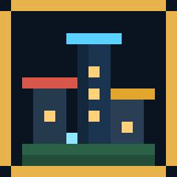
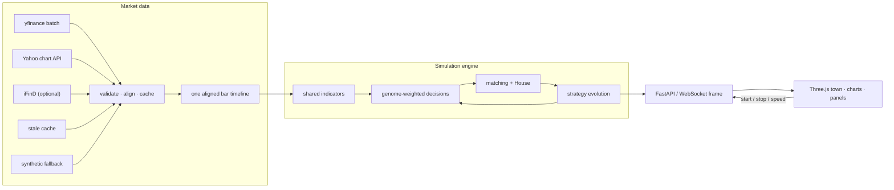
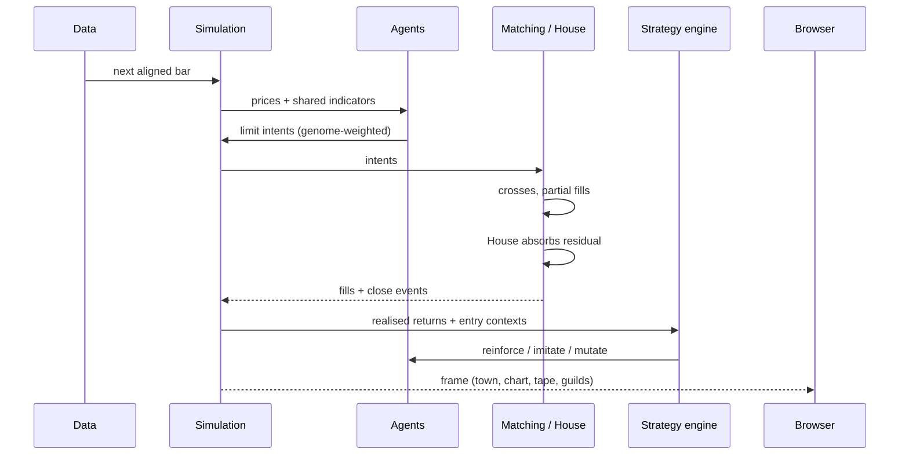
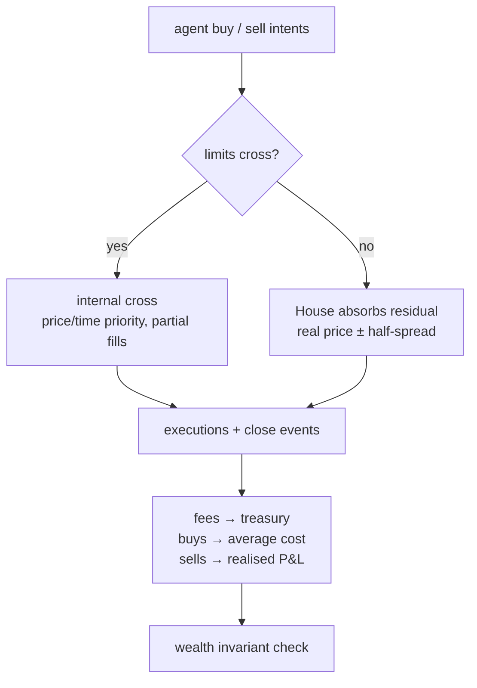
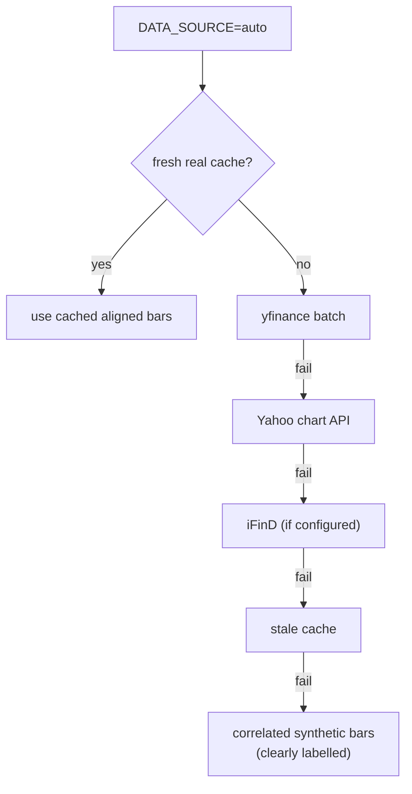

<div align="center">


</div>

<p align="center">
  
</p>

<h1 align="center">AGENT STREET</h1>

<p align="center">
  <i>A 3D market diorama where sixteen MBTI traders learn from their P&amp;L,<br>
  form strategy guilds, and rewrite their own playbooks — while four observers watch.</i>
</p>

<p align="center">
  <sub><a href="README_CN.md">📖 中文文档</a> · <a href="#quick-start">Quick start</a> · <a href="#architecture">Architecture</a> · <a href="#strategy-evolution">Strategy evolution</a></sub>
</p>

---

> **The premise:** a strategy should not be a constant in a config file. It should be
> something an agent earns, borrows, mutates, and sometimes loses. Agent Street turns a
> real market replay into a small society where that happens in public — on a map you
> can orbit, in charts you can inspect, and in a ledger that must balance.


<p align="center"><sub>The town at dusk. The selected trader is in the <b>Strategy</b> tab, showing the
evolved signal genome and guild lineage. Trader labels appear only on hover/selection; the <b>Aa</b>
button toggles the landmark labels.</sub></p>

<p align="center">
  
</p>

<p align="center"><sub>10-second project intro · <a href="docs/agent-street-intro.mp4">watch the 1080p MP4</a></sub></p>

---

## Table of contents

1. [What you are looking at](#what-you-are-looking-at)
2. [Three things this project takes seriously](#three-things-this-project-takes-seriously)
3. [Architecture](#architecture)
4. [The town](#the-town)
5. [The traders and observers](#the-traders-and-observers)
6. [Strategy evolution](#strategy-evolution)
7. [The market](#the-market)
8. [Guilds: reading the emergent field](#guilds-reading-the-emergent-field)
9. [Interface](#interface)
10. [Quick start](#quick-start)
11. [Configuration](#configuration)
12. [Data pipeline](#data-pipeline)
13. [API](#api)
14. [Tests](#tests)
15. [Project layout](#project-layout)
16. [Design notes and limits](#design-notes-and-limits)
17. [Acknowledgments](#acknowledgments)
- [Research artifact](#research-artifact)

---

## What you are looking at

Each tick advances one validated historical bar. Sixteen traders see the same
cross-section, form memories, talk to neighbours, and submit limit orders. An explicit
House market maker absorbs whatever the town cannot cross, so the quoted price always
equals the real replay price. Trades close, returns are attributed to the signals that
produced them, and genomes drift. Conversations can transfer a better playbook. The
town slowly clusters into guilds of momentum, mean reversion, sentiment and contrarian
traders. Four observers — a physicist, a mathematician, a social engineer and a mystic —
publish competing readings of the same system.

The visual layer is not a mock-up: the Three.js town is generated from the same
`TOWN_MAP` that drives pathfinding; the candles are the bars the agents actually see;
the tape is the fills that actually moved cash.

---

## Research artifact

The repository also contains a reproducible empirical study of the simulation:

- **Frozen data**: seven 390-bar, five-session snapshots for AAPL, GOOGL, MSFT,
  TSLA and AMZN — one discovery window and six held-out windows. All 35
  symbol-windows were cross-checked bar-for-bar against the source endpoint
  (`experiments/data/` and `experiments/data/windows/`, SHA-256 in the metadata).
- **Base experiment**: 4 conditions (static priors, imitation only, learning only,
  full) × 16 seeds on the discovery window and × 8 seeds on each of six held-out
  windows = 256 runs, 300 ticks each; zero wealth-invariant failures.
- **Phase sweep**: 4 learning scales × 4 imitation scales × 8 seeds = 128 runs,
  250 ticks each; zero invariant failures.
- **Report**: [`experiments/REPORT.md`](experiments/REPORT.md).
- **Paper**: [`paper/main.tex`](paper/main.tex), with figures and an arXiv build
  guide in [`paper/README.md`](paper/README.md).

**Headline findings (multi-window).** Individual reward learning is a
*diversifying* force: it raises strategy diversity (+0.107 on held-out windows)
and moves signal genomes apart (final pairwise distance 0.320 vs. 0.157 for static
priors). Social imitation is a *coordinating* force: it raises trade synchrony
(+0.020) and order-flow imbalance (+0.041), and these effects hold across all six
held-out windows. The full system balances both: more diverse than static priors,
more coordinated than learning alone.

The discovery-window **performance advantage does not replicate**. On the
discovery window the full system beats static priors by +0.110 pp return and
0.084 pp lower drawdown; on the six held-out windows the same contrast is
−0.019 pp (p = .56) and drawdown is 0.034 pp *larger* (p = .15), while
learning-only is 0.056 pp worse (p = .005). Agents hold only ~32% exposure, and
an equal-weight market benchmark explains most of the return variation; there is
no alpha claim. The learning × imitation phase map shows coordination rising
monotonically with imitation, while return and drawdown are best at moderate
imitation and deteriorate at high imitation.

The observer audit is equally cautionary. The original composite cascade score
was uninformative, and its polarization term had the wrong sign. A revised
flow-based score predicts future *coordination* both in and out of sample
(ρ ≈ .59–.60 on held-out windows), but its discovery-window drawdown signal
(ρ = .61; run-level AUC .81) reverses out of sample (ρ = −.04; AUC .44), and the
event-level AUC is only .53. Polarization’s sign flips across windows. The flow
**level** is therefore a **coordination-persistence signal, not a validated
crash warning**; the app labels it *flow-alignment risk*.

A target-specific follow-up separates the four observers into different sensors:
the Physicist is a between-window volatility descriptor, the Mathematician tracks
trust structure, the Social Engineer’s flow level ranks runs but not events, and
the Mystic behaves as a placebo. The flow **change** 20 ticks before a drawdown
has a modest event-level AUC of **.61** (five of six held-out windows) but no
run-level signal; it is a candidate timing signal, not a validated warning.

---

## Three things this project takes seriously

### 1. Data you can defend

- **One timeline.** Every symbol is replayed on a single aligned timestamp index. The
  old per-symbol modulo replay is gone, so cross-sectional relationships are real.
- **Validation before simulation.** Non-finite and non-positive prices, duplicate
  timestamps, contradictory OHLC values and obvious bad prints are removed. High/low
  always contain open/close.
- **Cache, not hope.** Aligned bars are written atomically to `.cache/bars_*.json`
  (15 min TTL). Warm starts are ~50 ms and the app survives a Yahoo outage.
- **Honest fallback.** `yfinance → Yahoo chart → iFinD (optional) → stale cache →
  correlated synthetic`. The UI always says **LIVE / CACHED / SYNTHETIC**. Synthetic
  bars are never dressed up as live data.
- **Reads are pure.** `GET /api/market` and `/api/market/history` never advance the
  replay. Only the simulation loop calls `advance()`.

### 2. A ledger that balances

- Limit checks, price/time priority, partial fills, agent-to-agent crosses, and House
  absorption at `real price ± half-spread`.
- Fees are charged per side and capitalised into average cost; sells realise P&L;
  zero-share positions disappear.
- The House balance sheet and a fee treasury are tracked.
- Every 20 ticks the engine checks:

  ```
  Σ agent cash + Σ holdings·price + House cash + House holdings·price + fees = constant
  ```

- The invariant has held at zero failures across development runs. The test suite
  covers fees, partial fills, average cost, realised P&L, win rate and conservation.

### 3. Strategies that evolve

- Each trader has a **genome**: six signal weights plus risk, patience, contrarian and
  noise traits.
- A closed trade is a learning event. The realised return is attributed back to the
  signal components that were present at entry. Supportive weights grow after wins and
  shrink after losses.
- Conversations can **imitate** a higher-fitness playbook; trust gates the transfer and
  the Quant Lab boosts the learning rate.
- Small mutations keep the population from collapsing into one strategy.
- Strategies are classified into guilds and visualised as a living field.

---

## Architecture





---

## The town

A 20×14 diorama with a working road grid, three new social hubs, and fifteen locations.

```
Legend:  . grass   = horizontal road   | vertical road   # building
         * tree    ~ water            : sidewalk

***...|.....|....***
*.....|.....|......*
..###.|.###.|.###...
..###.|.###.|.###...
====================
......|.....|.......
..##..|.###.|..##...
..##..|.###.|..##...
::::::|:::::|:::::::
...*..|..~~.|..*....
...*..|..~~.|..*....
::::::|:::::|:::::::
......|.###.|.......
.**..*|.###.|*..**..
```

| Location | Center | Role |
|---|---|---|
| 🔵 Blue Roof House | (3, 2) | INTJ · INTP · ENTJ · ENTP |
| 🔴 Red Roof House | (9, 2) | INFJ · INFP · ENFJ · ENFP |
| 🟢 Green Roof House | (15, 2) | ISTJ · ISFJ · ESTJ · ESFJ |
| 🟤 Yellow Roof House | (2, 6) | ISTP · ISFP · ESTP · ESFP |
| ☕ Morning Brew Cafe | (9, 6) | social buzz, herding |
| 📚 Data Library | (15, 6) | quiet analysis |
| 📊 Trading Floor | (2, 9) | fast reactions |
| 🌿 Willow Park | (11, 9) | independent thought |
| 🌳 Town Square | (9, 12) | crowd courage |
| 🔭 Observatory | (17, 10) | physicist |
| 📐 Math Tower | (18, 2) | mathematician |
| 🔮 Fortune Tent | (1, 11) | mystic |
| **📰 Rumor Mill** | **(5, 5)** | **herding +25%, faster reactions** |
| **🧪 Quant Lab** | **(13, 10)** | **analysis + learning-rate boost** |
| **🏛️ Guild Hall** | **(5, 10)** | **debate, coalition and imitation** |

The new hubs are not decoration. They modify the environment parameters the traders
experience and create places where strategies can spread:

- **Rumor Mill** increases herding and reaction speed. Narratives get loud here.
- **Quant Lab** raises tech weighting and extends holding periods; closes made while
  an agent is at the lab receive a **1.7× learning-rate boost**.
- **Guild Hall** raises herding and risk appetite; conversations here slightly increase
  imitation probability. It is also the Social Engineer's home.

The day/night cycle is stylised independently of the market clock: each replay day runs
from dawn through dusk into night, with emissive windows, street lamps, stars, fireflies
and occasional rain. The town is rendered with Three.js r160, vendored locally; there is
no build step.

---

## The traders and observers

### 16 MBTI traders

Each trader starts with a genome derived from its MBTI dimensions. The genome is a
**prior**, not a destiny: it is edited by realised P&L, copied from peers and mutated.

| ID | Name | Instinct | Starts near |
|---|---|---|---|
| INTJ | Architect | Quant analyst, sees patterns before they form | 📚 |
| INTP | Logician | Data obsessive, needs ten signals to act | 📚 |
| ENTJ | Commander | Treats the market like a battlefield | 📊 |
| ENTP | Debater | Contrarian, fades consensus | ☕ |
| INFJ | Advocate | Reads sentiment like a therapist | 🌿 |
| INFP | Mediator | Trades visual harmony | 🌿 |
| ENFJ | Protagonist | Community leader; calls get followed | 🌳 |
| ENFP | Campaigner | Every trade is the next big thing | ☕ |
| ISTJ | Logistician | Retired accountant, process over noise | 📊 |
| ISFJ | Defender | Capital preservation first | 🏠 |
| ESTJ | Executive | Military discipline, hates indecision | 📊 |
| ESFJ | Consul | FOMO-driven; buys what others buy | 🌳 |
| ISTP | Virtuoso | Precise entries during lunch break | ☕ |
| ISFP | Adventurer | Trades by rhythm and feel | 🌿 |
| ESTP | Entrepreneur | Ex-poker pro, thrives on volatility | ☕ |
| ESFP | Entertainer | Every trade is a performance | 🌳 |

### 4 observers

| Agent | Lens | What it reads | Confidence |
|---|---|---|---|
| 🔭 **Physicist** | statistical mechanics | order parameter, dispersion, susceptibility, correlation length, strategy diversity | 70–85% |
| 📐 **Mathematician** | graph theory | trust components, centrality, sentiment partition, guild composition, diversity | 75–95% |
| 🧩 **Social Engineer** | social systems | trust density, broker concentration, clustering, polarization, **order-flow alignment**, imitation flow, **flow-alignment risk**, interventions | 66–90% |
| 🔮 **Mystic** | tea leaves | cosmic resonance, karmic debt, the Dao of market coupling | 5–45% |

Observers do not trade. They publish roughly every 20 ticks. The Social Engineer also
reads the **strategy ecosystem**: guild counts, dominant playbook, mutation/imitation
events, order-flow alignment, and the latest adaptation. Its reports include a concrete
intervention, e.g. *"encourage cross-guild disagreement at the Guild Hall"* when flow
alignment rises. The original composite cascade score was audited and replaced by a
flow-based score. The multi-window study shows that the revised score predicts order-flow
**coordination** in and out of sample, but **not future drawdown** out of sample; it is a
flow-alignment/coordination signal, not a validated crash warning. Reports label it
*flow-alignment risk*.

---

## Strategy evolution

Each trader owns a small, inspectable genome:

```
signal weights:  trend · reversion · RSI · herding · influence · memory   (sum = 1)
traits:          risk · patience · contrarian · noise
lineage:         generation · wins · losses · adaptations · last adaptation
```

### 1. Prior

`genome_from_persona()` translates MBTI-derived parameters into an initial genome.
A contrarian introvert starts with a large reversion weight; an extraverted feeler
starts with more herding and memory.

### 2. Experience

Every buy carries the signal context that produced it. When the position closes, the
realised return becomes a reward:

```
reward    = clip(trade_return / 2%, -1, 1)
Δw_signal = η · reward · entry_signal
```

Supportive signals are reinforced after wins and down-weighted after losses. Risk and
patience also adapt. The update is a lightweight, online, reward-modulated learner — not
a claim of alpha; it is a mechanism for visible behavioural change.

### 3. Imitation

After a conversation, a lower-fitness trader may borrow a blend of a higher-fitness
trader's playbook:

```
learner_gene ← 0.76 · learner_gene + 0.24 · teacher_gene + mutation
```

The trust graph gates the probability; the Quant Lab adds a large bonus, the Guild Hall
a small one. This is how strategy guilds form.

### 4. Mutation

Every 20 ticks, a small fraction of genomes explore a random variation. Mutations that
change the dominant signal show up as guild drift in the observers' reports.

### 5. Guilds

Genomes are classified as **momentum**, **mean reversion**, **sentiment**, **contrarian**
or **balanced**. The result is not a leaderboard of fixed personalities; it is a
population that can split, cluster, imitate and drift.

<p align="center">
  
  <br>
  <sub>The Strategy tab: family, generation, fitness, learned signal weights and traits.</sub>
</p>

---

## The market

### Signals

The shared indicator engine computes, per symbol and per tick:

```
trend       = tanh(momentum_5 / (realised_vol × √5))
reversion   = -tanh((close − SMA20) / ATR14)
rsi_signal  = (50 − RSI14) / 50
social      = herding · herd + influence · trust + memory · memory_sentiment
composite   = Σ genome_weights × signals + bounded noise
```

The genome weights sum to one, so the composite remains in `[-1, 1]` before noise.
Contrarians flip the trend component and amplify reversion. Each decision cycle allows
one deliberate order per agent, which keeps the tape readable.

### Matching and the House



The House is what makes the town's quoted price equal the real replay price. Agents do
not move the market — by design. They compete for execution, sentiment and survival
within it. A replay loop starts a **new season**: portfolios, memories, observers and
strategy lineages reset together, so the ledger is coherent across the loop boundary.

### Risk metrics

Each trader now reports **max drawdown**, **win rate over closed trades**, and the
number of closed trades. These live in the Account tab alongside equity, cash, realised
and unrealised P&L.

---

## Guilds: reading the emergent field


The **Guilds** tab turns the population of strategies into a field:

- x-axis: trend weight; y-axis: reversion weight
- each point is a trader, coloured by guild, sized by generation
- direct labels for the highest-fitness points; hover any point for its full genome
- the legend shows guild counts, average fitness and the latest adaptation
- the top line shows the ecosystem generation and dominant playbook

Clusters are meaningful. A dense contrarian cluster near the Rumor Mill, a momentum
cluster near the Trading Floor, a broker who bridges both, a quiet lab agent whose
weights are drifting — these are the visible footprints of the social system.

The Social Engineer's report reads the same data differently: trust density, broker
degree, clustering coefficient, polarization, order-flow alignment, imitation count and
a flow-risk score (polarization is treated as a disagreement buffer). The Mathematician
reads partitions and components. The Physicist reads order parameters and susceptibility.
The original composite cascade score was audited against future outcomes and replaced by
the flow-based score. Multi-window experiments show that the flow score predicts future
coordination in and out of sample, but not future drawdown out of sample; it is a
coordination-persistence signal, not a crash warning. Four lenses, one system.

---

## Interface

| Panel | What it shows |
|---|---|
| **The Town** | Three.js diorama; drag to orbit, scroll to zoom, hover/click an agent; **Aa** toggles location labels. Trader labels are hidden until hover/selection, so the scene stays legible. |
| **Market** | **Candles** (OHLC + volume + MA9/MA21), **Compare** (normalised lines), **Guilds** (strategy field) |
| **Leaderboard** | Mark-to-market equity, return and each trader's current guild code; click to inspect |
| **Stats strip** | Total equity, crowd sentiment meter, breadth, trading fees |
| **Agent · Account** | Equity sparkline, cash, realised/unrealised P&L, positions, max drawdown, win rate, closed trades, composite signals, holdings, thoughts |
| **Agent · Strategy** | Guild, generation, fitness, learned signal weights, risk/patience/contrarian/noise, latest adaptation |
| **Observers** | Four cards — Physicist, Mathematician, Social Engineer, Mystic — with confidence |
| **Tape** | Live executions: side, size, price, reason, counterparty, fee, cross/house |

Keyboard: **Space** start/stop · **R** reset · **C** reset camera.

---

## Quick Start

```bash
git clone https://github.com/huiihao/agent-street.git
cd agent-street
pip install -r requirements.txt
python run.py
```

Open **http://localhost:8766** and press **Start**.

- ✅ No API key required.
- 📡 Uses yfinance / Yahoo's public chart endpoint; a warm cache is used when available.
- 🧪 Offline? The app clearly falls back to labelled synthetic bars.
- 🎨 Three.js is vendored under `frontend/vendor/three`; no npm or bundler.

```bash
# Tests
python -m unittest discover -s tests -v
```

---

## Configuration

Every value can be overridden with an environment variable. Defaults live in
`backend/config.py`.

| Variable | Default | Meaning |
|---|---|---|
| `SYMBOLS` | `AAPL,GOOGL,MSFT,TSLA,AMZN` | Universe (comma-separated) |
| `INITIAL_CASH` | `10000` | Starting cash per trader |
| `TICK_INTERVAL_SEC` | `1.5` | Real seconds per replay bar |
| `MAX_SPEED` | `20` | Speed cap |
| `BUY_THRESHOLD` / `SELL_THRESHOLD` | `0.12` / `-0.10` | Composite thresholds |
| `MAX_POSITION_PCT` | `0.32` | Position cap (before risk scaling) |
| `FEE_BPS` / `SLIPPAGE_BPS` | `2` / `3` | Fees and House half-spread |
| `HIST_DAYS_BACK` | `5` | Trading sessions to load |
| `HIST_INTERVAL` | `5m` | `1m / 5m / 15m / 30m / 1h` |
| `WARMUP_BARS` | `30` | Bars consumed before replay starts |
| `CACHE_TTL_SEC` | `900` | Fresh-cache lifetime |
| `DATA_SOURCE` | `auto` | `auto / yfinance / yahoo_chart / ifind / alphavantage / synthetic` |
| `SIM_SEED` | `7` | Deterministic decisions/synthetic data (`0` = random) |
| `ALPHA_VANTAGE_API_KEY` | empty | Explicit source only |
| `IFIND_API_KEY` / `IFIND_API_SECRET` | empty | Optional institutional iFinD |
| `LLM_ENABLED` | `false` | Background LLM reflection enrichment |
| `LLM_API_KEY` | empty | OpenAI-compatible key |
| `LLM_BASE_URL` / `LLM_MODEL` | OpenAI / `gpt-4o-mini` | Any compatible endpoint |
| `LLM_CONVERSATIONS` | `false` | Opt-in LLM conversation lines |

```powershell
# Windows PowerShell
$env:SYMBOLS="AAPL,NVDA,META"
$env:HIST_INTERVAL="1m"
$env:DATA_SOURCE="yfinance"
python run.py
```

```bash
# Linux / macOS
SYMBOLS=AAPL,NVDA,META HIST_INTERVAL=1m python run.py
```

---

## Data pipeline



| Concern | Implementation |
|---|---|
| Time zones | Bars normalised to UTC; replay clock displayed in `America/New_York` |
| Alignment | Timestamp intersection; limited forward-fill union fallback |
| Validation | Finite/positive prices, OHLC repair, bad-wick filter, duplicate removal |
| History | Trimmed to the last `HIST_DAYS_BACK` trading sessions |
| Cache | `.cache/bars_{interval}_{days}_{hash}.json`, atomic writes, 15 min TTL |
| Transparency | Source, cache age, warnings and dropped symbols in `/api/status` and the UI |
| Warm-up | `WARMUP_BARS` bars prime indicators before replay starts |

---

## API

| Endpoint | Purpose |
|---|---|
| `GET /api/bootstrap` | Personas, town, aligned history, source, recent reports/trades |
| `GET /api/status` | Tick, speed, bar progress, source, cache warnings, invariant failures |
| `GET /api/market` | Read-only current bar (never advances) |
| `GET /api/market/history?limit=180` | Read-only aligned bars ending at the replay index |
| `GET /api/health` | `ok` only for real, non-stale data |
| `GET /api/town`, `GET /api/personas` | Static definitions (20 agents, 15 locations) |
| `POST /api/sim/start` / `stop` / `reset` | Control |
| `WS /ws` | Frames, sim state, hello, speed, reset, ping |

---

## Tests

```bash
python -m unittest discover -s tests -v
```

**21 tests**, covering:

- bar cleaning, OHLC repair and timezone handling
- multi-symbol intersection alignment and cache round-trips
- synthetic cross-sectional correlation
- indicator direction and bounds
- limit enforcement, partial fills, fees and average cost
- realised P&L, win rate, close events and the wealth invariant
- strategy priors, reward updates, mutation/learning state and guild reporting

The runtime has also been exercised with a small synthetic provider to verify that a
replay loop resets portfolios, strategy generations, observers and the House treasury
together.

---

## Project layout

```
agent-street/
├── backend/
│   ├── main.py                  # FastAPI: bootstrap, status, market, WebSocket
│   ├── config.py                # env-overridable configuration
│   ├── ws_manager.py            # frame serialisation + bounded broadcasts
│   ├── engine/
│   │   ├── simulation.py        # tick loop, sessions, snapshots, accounting
│   │   ├── market_data.py       # fetch, validate, align, cache, synthetic
│   │   ├── indicators.py        # shared momentum/RSI/ATR/volatility engine
│   │   ├── strategy.py          # genomes, reward learning, imitation, guilds
│   │   ├── persona_engine.py    # genome-weighted, risk-managed decisions
│   │   ├── matching_engine.py   # crosses, House, fees, close events
│   │   ├── memory_system.py     # grounded observations → reflections
│   │   ├── conversation.py      # cooldowns, debates, optional LLM
│   │   ├── observer_engine.py   # physicist, mathematician, social engineer, mystic
│   │   ├── daily_routine.py     # schedules + BFS movement
│   │   ├── influence_network.py # trust graph + environment modifiers
│   │   ├── ifind_connector.py   # optional iFinD connector
│   │   └── llm_client.py        # async OpenAI-compatible client
│   ├── models/                  # portfolio, market frames, town map
│   └── mbti/                    # personality definitions and priors
├── frontend/
│   ├── index.html
│   ├── assets/                  # icon.svg / icon-192 / icon-512
│   ├── css/style.css
│   ├── js/
│   │   ├── main.js              # bootstrap, WebSocket, controls
│   │   ├── town3d.js            # Three.js diorama + agents + lighting
│   │   ├── market_chart.js      # candles / compare / guilds / tooltips
│   │   ├── leaderboard.js       # DOM leaderboard + guild codes
│   │   ├── agent_detail.js      # Account / Strategy tabs
│   │   ├── observer_reports.js  # four observer cards
│   │   ├── trade_feed.js
│   │   ├── ws_client.js
│   │   └── utils.js
│   └── vendor/three/            # pinned Three.js r160 + OrbitControls
├── tests/
│   ├── test_market_data.py
│   ├── test_indicators.py
│   ├── test_matching.py
│   └── test_strategy.py
├── experiments/
│   ├── data/                    # discovery snapshot + provenance metadata
│   │   └── windows/             # six held-out frozen windows
│   ├── results/                 # discovery CSVs, tables, results.json
│   ├── results_windows/         # six held-out window runs
│   ├── results_sweep/           # learning x imitation phase sweep
│   ├── results_v1/              # v1 observer reports for the audit
│   ├── figures/                 # PDF/PNG figures
│   ├── fetch_windows.py         # freeze + cross-check held-out windows
│   ├── run_experiment.py        # base ablation / phase sweep runner
│   ├── analyze_results.py       # discovery statistics + figures
│   ├── analyze_extensions.py    # multi-window, phase map, OOS observer audit
│   ├── analyze_strategy.py      # genome divergence + guild lineage
│   ├── analyze_observer_targets.py  # observer x target map + delta-flow event study
│   └── REPORT.md
├── paper/
│   ├── main.tex                 # arXiv-style manuscript
│   ├── refs.bib
│   ├── README.md                # build / arXiv notes
│   └── figures/
├── docs/
│   ├── icon.svg                 # project icon (vector)
│   ├── icon.png                 # 512px icon
│   ├── icon-224.png             # 2x README icon
│   ├── icon-1024.png            # high-resolution icon
│   ├── screenshot.png
│   ├── screenshot-guilds.png
│   ├── agent-street-intro.gif  # README intro animation
│   ├── agent-street-intro.mp4  # 1080p intro
│   ├── screenshot-strategy.png
│   └── screenshot.gif
├── requirements.txt
└── run.py                       # http://localhost:8766
```

---

## Design notes and limits

- **The House absorbs residual flow.** This is deliberate: the town price tracks the
  real replay price, so agents cannot invent alpha by moving the market. Their P&L
  comes from timing, sizing and execution against each other and the House.
- **A replay loop is a new season.** Portfolios, memories, strategy generations, the
  House treasury and observers reset together. This avoids a mark-to-market jump at
  the loop boundary and keeps the invariant meaningful.
- **The learner is lightweight.** It is an online reward-modulated update with
  imitation and mutation — designed for visible behaviour and inspectability, not as a
  production alpha model.
- **No live trading.** This is a simulation. No broker integration, no real orders, no
  financial advice.
- **Optional dependencies.** yfinance is the default; iFinD and Alpha Vantage are
  optional and explicitly selected. Synthetic data is always labelled.
- **LLM is optional.** Rule-based reflections and conversations are always available;
  LLM enrichment runs in background tasks with concurrency limits and timeouts.

---

## Acknowledgments

- 🏘️ [Generative Agents (Park et al., 2023)](https://github.com/joonspk-research/generative_agents) — memory streams, reflection, Smallville
- 🧠 MBTI personality theory — used as an evolvable behavioural prior, not a verdict
- 🎮 [Three.js](https://threejs.org/) — the diorama renderer
- 📡 [yfinance](https://github.com/ranaroussi/yfinance) — public market data
- 📊 The dark chart palette follows a validated categorical/diverging scheme, so guild
  identity never depends on colour alone.

---

<div align="center">
  <sub>Made with ❤️ · MIT License · <a href="https://github.com/huiihao/agent-street">github.com/huiihao/agent-street</a></sub>
</div>
