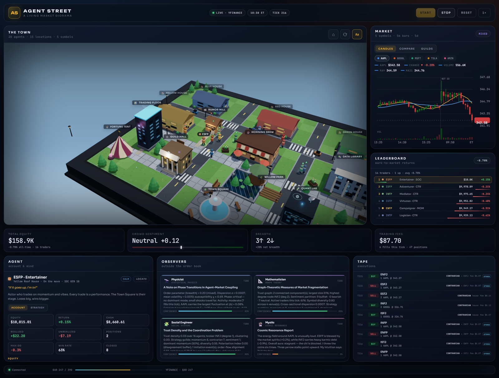
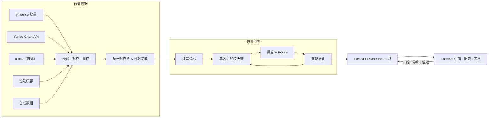
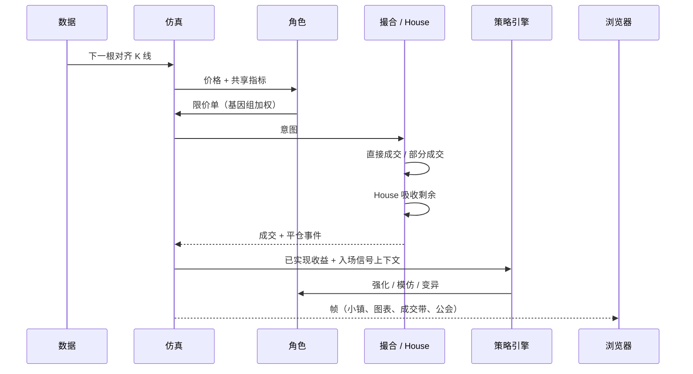
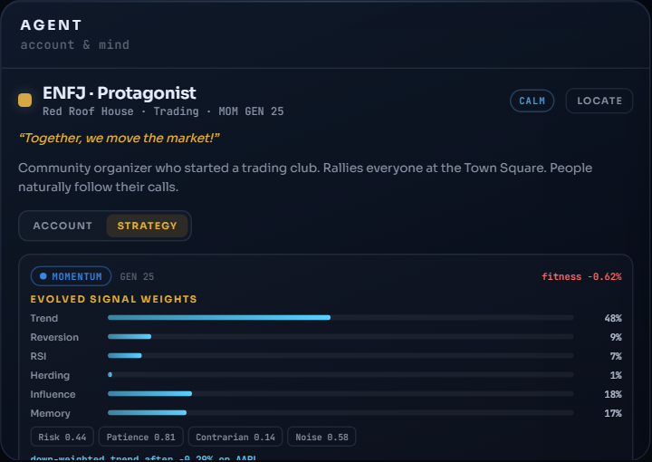
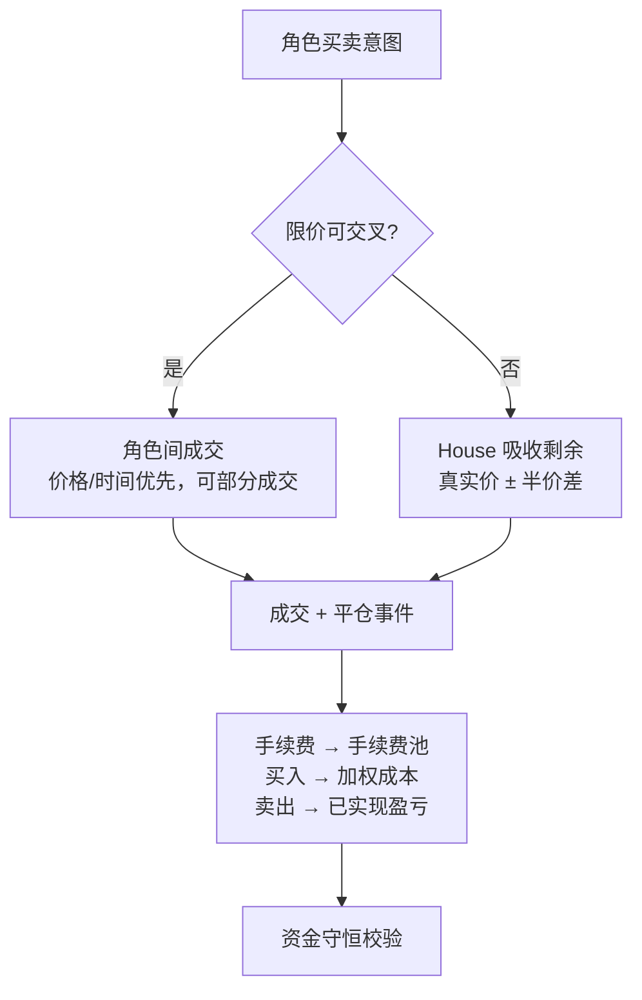
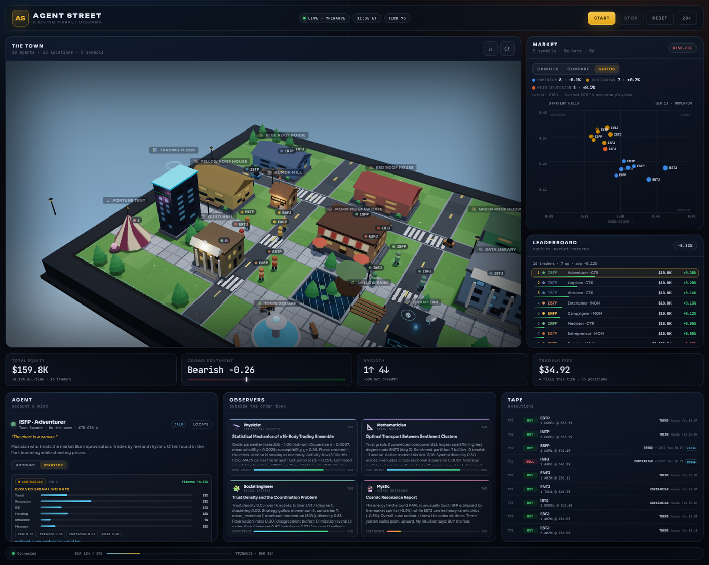
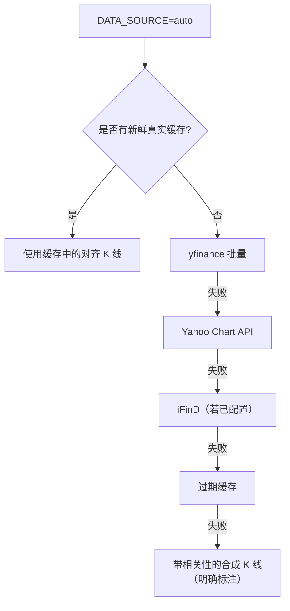

<div align="center">


</div>

<h1 align="center">AGENT STREET</h1>

<p align="center">
  <i>一座会学习的 3D 市场小镇：16 位 MBTI 交易员从盈亏中积累经验、<br>
  模仿同伴、变异策略，形成策略公会；4 位观察者从外部解读这一切。</i>
</p>

<p align="center">
  <sub><a href="README.md">📖 English</a> · <a href="#快速开始">快速开始</a> · <a href="#架构">架构</a> · <a href="#策略进化">策略进化</a></sub>
</p>

---

> **核心想法：** 策略不应该是配置文件里的常数。它应该由角色在真实行情回放中
> **赚到、借来、变异、甚至失去**。Agent Street 把这件事放到一座可旋转、可点击、
> 可检查的立体小镇里，并保证每一笔资金都能对上账。



<p align="center"><sub>黄昏中的小镇。选中的交易员打开 <b>Strategy</b> 标签，展示经过 16 代
实盘交易后漂移到 33% 均值回归权重的策略基因组。</sub></p>

---

## 目录

1. [你会看到什么](#你会看到什么)
2. [三个认真对待的问题](#三个认真对待的问题)
3. [架构](#架构)
4. [小镇](#小镇)
5. [交易员与观察者](#交易员与观察者)
6. [策略进化](#策略进化)
7. [市场计算与撮合](#市场计算与撮合)
8. [Guilds：阅读涌现的策略场](#guilds阅读涌现的策略场)
9. [界面](#界面)
10. [快速开始](#快速开始)
11. [配置](#配置)
12. [数据管线](#数据管线)
13. [API](#api)
14. [测试](#测试)
15. [目录结构](#目录结构)
16. [设计说明与边界](#设计说明与边界)
17. [致谢](#致谢)
- [实验与论文](#实验与论文)

---

## 你会看到什么

每个 tick 推进一根经过校验的历史 K 线。16 位交易员看到同一份横截面数据，形成记忆、
与邻居交谈，并提交限价单。House 做市商吸收所有无法撮合的剩余订单，因此小镇报价
始终等于真实回放价。成交结束后，收益被归因到当初产生这笔交易的信号上，策略基因组
随之漂移；对话可以把更好的玩法从一个角色传给另一个角色。小镇逐渐聚成动量、均值回归、
情绪和逆向等策略公会。4 位观察者——物理学家、数学家、社会工程学家、神秘主义者——
用完全不同的语言解读同一个系统。

视觉层不是贴图：Three.js 小镇由驱动寻路的同一份 `TOWN_MAP` 生成；K 线就是角色看到的
真实 K 线；成交带里的每一笔都真实改变了现金。

---

## 实验与论文

仓库同时包含一套可复现的实证研究：

- **冻结数据**：7 个 390 根、5 个交易日的 5 分钟快照（AAPL、GOOGL、MSFT、TSLA、AMZN）：
  1 个发现窗口 + 6 个隐藏窗口。全部 35 个“标的 × 窗口”都与数据源端点逐 bar 交叉校验
  （`experiments/data/` 与 `experiments/data/windows/`，SHA-256 见元数据）。
- **基准实验**：4 种条件（静态先验、仅模仿、仅学习、完整）× 发现窗口 16 seeds
  + 6 个隐藏窗口各 8 seeds = 256 次运行，每次 300 ticks；资金守恒失败 0 次。
- **参数相图**：4 个学习强度 × 4 个模仿强度 × 8 seeds = 128 次运行，每次 250 ticks；
  资金守恒失败 0 次。
- **实验报告**：[`experiments/REPORT.md`](experiments/REPORT.md)。
- **论文**：[`paper/main.tex`](paper/main.tex)，图表与 arXiv 编译说明在
  [`paper/README.md`](paper/README.md)。

**多窗口核心发现。** 个体奖励学习是一股“分化”力量：在 6 个隐藏窗口上，它将策略多样性
提高 +0.107，并把信号基因组平均两两距离从静态先验的 0.157 推高到 0.320。社会模仿是一股
“协调”力量：它把交易同步提高 +0.020、订单流失衡提高 +0.041，且在全部 6 个隐藏窗口上
方向一致。完整系统同时具备两者：比静态先验更多样，也比“仅学习”更协调。

发现窗口的**收益优势不能复现**：在发现窗口，完整系统相对静态先验的收益为 +0.110 pp、
回撤改善 0.084 pp；但在 6 个隐藏窗口上，同一对比的收益为 −0.019 pp（p = .56），回撤反而
扩大 0.034 pp（p = .15），仅学习条件比静态先验差 0.056 pp（p = .005）。小人平均只有约
32% 的股票暴露，等权市场基准解释了大部分收益变化；这不是 alpha。学习 × 模仿相图显示：
协调性随模仿强度单调上升，但收益和回撤在中等模仿强度（学习 1×、模仿 0.5×）最好，高模仿
反而恶化。

观察者审计同样是一个警示。原版复合级联分数没有预测力，且极化项符号与风险标签相反；修正后
的订单流分数在样本内和样本外都能预测未来**协调性**（隐藏窗口 ρ ≈ .59–.60），但它在发现
窗口的回撤信号（ρ = .61；run-level AUC .81）在样本外反转为（ρ = −.04；AUC .44），
event-level AUC 仅 .53。极化项的符号在不同窗口间翻转。因此，流分数的**水平值**是
**协调持续性信号，不是经过验证的崩盘预警**；应用里把它标为 *flow-alignment risk*。

进一步的“观察者 × 目标”审计把四位观察者拆成不同传感器：物理学家是窗口间的波动率描述器，
数学家追踪信任结构，社会工程学家的流分数水平能区分运行但不能区分事件，神秘主义者则更像
placebo。流分数的**变化量**在回撤前 20 ticks 有 modest 的 event-level AUC **.61**
（6 个隐藏窗口中的 5 个），但 run-level 只有 .50；它是候选的时点信号，不是已验证的预警。

---

## 三个认真对待的问题

### 1. 经得起推敲的数据

- **一条时间轴。** 所有标的使用同一个对齐时间索引，标的之间的横截面关系是真实的。
- **先校验再仿真。** 剔除 NaN/非正价格、重复时间戳、OHLC 矛盾和明显坏点；保证
  `high ≥ max(open, close)`、`low ≤ min(open, close)`。
- **缓存，而不是祈祷。** 对齐后的数据以原子写入保存到 `.cache/bars_*.json`
  （15 分钟 TTL）。热启动约 50ms，Yahoo 暂时不可用也能继续。
- **诚实的降级链。** `yfinance → Yahoo Chart → iFinD（可选）→ 过期缓存 → 带共同
  市场因子的合成数据`。UI 永远明确显示 **LIVE / CACHED / SYNTHETIC**，不会把假数据
  伪装成实时行情。
- **读取无副作用。** `GET /api/market` 与 `/api/market/history` 永不推进回放。

### 2. 能对上的资金账本

- 限价校验、价格/时间优先、部分成交、角色间直接成交、House 按真实价 ± 半价差吸收。
- 每边手续费计入持仓成本；卖出计算已实现盈亏；清空零股。
- 独立追踪 House 现金、持仓和手续费池。
- 每 20 ticks 校验：

  ```
  Σ 角色现金 + Σ 持仓×价格 + House 现金 + House 持仓×价格 + 手续费 = 常数
  ```

- 开发运行中守恒失败次数保持 0；测试覆盖手续费、部分成交、加权成本、已实现盈亏、
  胜率与资金守恒。

### 3. 会进化的策略

- 每位交易员有一个**基因组**：6 个信号权重 + 风险、耐心、逆向、噪声 4 个特征。
- 每笔平仓都是一次学习事件：收益被归因到入场时存在的信号分量；支持过盈利交易的
  权重上升，支持过亏损交易的权重下降。
- 对话可以进行**模仿**：信任关系和相对适应度决定是否借用更好的玩法；Quant Lab
  会提高学习率。
- 小概率**变异**防止种群塌缩成单一策略。
- 策略被归类为公会，并在 Guilds 视图中呈现为一个不断变化的场。

---

## 架构





---

## 小镇

20×14 的立体底座，完整路网，以及三个新的社交枢纽，共 15 个地点。

```
图例：  . 草地   = 横向道路   | 纵向道路   # 建筑
         * 树    ~ 水面      : 人行道

***...|.....|....***
*.....|.....|......*
..###.|.###.|.###...
..###.|.###.|.###...
====================
......|.....|.......
..##..|.###.|..##...
..##..|.###.|..##...
::::::|:::::|:::::::
...*..|..~~.|..*....
...*..|..~~.|..*....
::::::|:::::|:::::::
......|.###.|.......
.**..*|.###.|*..**..
```

| 地点 | 中心 | 作用 |
|---|---|---|
| 🔵 Blue Roof House | (3, 2) | INTJ · INTP · ENTJ · ENTP |
| 🔴 Red Roof House | (9, 2) | INFJ · INFP · ENFJ · ENFP |
| 🟢 Green Roof House | (15, 2) | ISTJ · ISFJ · ESTJ · ESFJ |
| 🟤 Yellow Roof House | (2, 6) | ISTP · ISFP · ESTP · ESFP |
| ☕ Morning Brew Cafe | (9, 6) | 社交、羊群效应 |
| 📚 Data Library | (15, 6) | 安静分析 |
| 📊 Trading Floor | (2, 9) | 快速反应 |
| 🌿 Willow Park | (11, 9) | 独立思考 |
| 🌳 Town Square | (9, 12) | 人群勇气 |
| 🔭 Observatory | (17, 10) | 物理学家 |
| 📐 Math Tower | (18, 2) | 数学家 |
| 🔮 Fortune Tent | (1, 11) | 神秘主义者 |
| **📰 Rumor Mill** | **(5, 5)** | **羊群 +25%，反应更快** |
| **🧪 Quant Lab** | **(13, 10)** | **技术权重更高，学习率提升** |
| **🏛️ Guild Hall** | **(5, 10)** | **辩论、联盟与模仿** |

新地点不是装饰：

- **Rumor Mill** 提高羊群权重和反应速度，叙事在这里传播得最快。
- **Quant Lab** 提高技术权重与持有期；在实验室里完成的平仓获得 **1.7× 学习率加成**。
- **Guild Hall** 提高羊群与风险偏好，对话中的模仿概率略升；它也是社会工程师的驻地。

昼夜循环独立于市场时钟：每个回放日从清晨走到深夜，伴随发光窗户、路灯、星空、萤火虫
和偶发降雨。Three.js r160 已本地 vendor，无需构建步骤。

---

## 交易员与观察者

### 16 位 MBTI 交易员

每位交易员的初始基因组来自 MBTI 维度。基因组是**先验**，不是宿命：它会被盈亏修改、
被同伴模仿、被随机变异。

| ID | 名称 | 交易直觉 | 常去 |
|---|---|---|---|
| INTJ | 建筑师 | 量化分析师，在形态形成前看见形态 | 📚 |
| INTP | 逻辑学家 | 数据强迫症，要十个确认信号才动手 | 📚 |
| ENTJ | 指挥官 | 把市场当战场 | 📊 |
| ENTP | 辩论家 | 天生反骨，专和市场共识对着干 | ☕ |
| INFJ | 提倡者 | 像读病人一样读市场情绪 | 🌿 |
| INFP | 调停者 | 按图表的视觉和谐感交易 | 🌿 |
| ENFJ | 主人公 | 社区领袖，大家会跟随他的判断 | 🌳 |
| ENFP | 竞选者 | 每一笔交易都是“下一个大机会” | ☕ |
| ISTJ | 物流师 | 退休会计，流程大于噪音 | 📊 |
| ISFJ | 守卫者 | 本金安全高于一切 | 🏠 |
| ESTJ | 总经理 | 军事化纪律，讨厌犹豫 | 📊 |
| ESFJ | 执政官 | FOMO 驱动，别人买什么就买什么 | 🌳 |
| ISTP | 鉴赏家 | 机械师，午休时精准进场 | ☕ |
| ISFP | 探险家 | 音乐人，按节奏和手感交易 | 🌿 |
| ESTP | 企业家 | 前扑克选手，靠波动率吃饭 | ☕ |
| ESFP | 表演者 | 每笔交易都是一场演出 | 🌳 |

### 4 位观察者

| 观察者 | 视角 | 读取内容 | 置信度 |
|---|---|---|---|
| 🔭 **物理学家** | 统计力学 | 序参量、离散度、磁化率、关联长度、策略多样性 | 70–85% |
| 📐 **数学家** | 图论 | 信任连通分量、中心性、情绪分区、公会构成、多样性 | 75–95% |
| 🧩 **社会工程学家** | 社会系统 | 信任密度、经纪人集中度、聚类、极化、**订单流同步**、模仿流、**流对齐风险**、干预建议 | 66–90% |
| 🔮 **神秘主义者** | 茶叶 | 宇宙共振、因果业力、市场耦合之道 | 5–45% |

观察者不交易，大约每 20 ticks 发布一次报告。社会工程学家还会读取**策略生态**：
公会数量、主导玩法、变异/模仿事件、订单流同步、最新适应记录，并给出具体干预建议。
原版复合级联分数经过实验审计后被订单流分数替代。多窗口实验表明：修正分数在样本内和
样本外都能预测订单流**协调性**，但不能在样本外预测未来回撤；它是协调持续性信号，不是
经过验证的崩盘预警。报告里把它标为 *flow-alignment risk*。

---

## 策略进化

每位交易员拥有一个可检查的小型基因组：

```
信号权重：  trend · reversion · RSI · herding · influence · memory   （总和 = 1）
特征：      risk · patience · contrarian · noise
谱系：      generation · wins · losses · adaptations · lastAdaptation
```

### 1. 先验

`genome_from_persona()` 把 MBTI 参数翻译成初始基因组。逆向型内向者一开始有更高的
均值回归权重；外向情感型一开始更依赖羊群和记忆。

### 2. 经验学习

每次买入都会携带产生它的信号上下文。平仓时，已实现收益变成奖励：

```
reward    = clip(单笔收益率 / 2%, -1, 1)
Δw_signal = η · reward · 入场信号
```

盈利后支持过这笔交易的信号权重上升；亏损后下降。风险与耐心也会适应。这是一个
轻量级的在线奖励调制学习器，不宣称 alpha，只负责让行为可见地变化。

### 3. 模仿

对话之后，适应度较低的交易员可能借用更高适应度交易员的玩法：

```
learner_gene ← 0.76 · learner_gene + 0.24 · teacher_gene + 变异
```

信任图决定概率；Quant Lab 提供较大加成，Guild Hall 提供小幅加成。策略公会就是这样
形成的。

### 4. 变异

每 20 ticks，一小部分基因组会探索随机变异。主导信号发生变化的变异会以“公会漂移”
出现在观察者报告中。

### 5. 公会

基因组被分类为 **动量**、**均值回归**、**情绪**、**逆向** 或 **平衡**。最终得到的不是
固定人格排行榜，而是一个会分裂、聚集、模仿和漂移的种群。

<p align="center">
  
  <br>
  <sub>Strategy 标签：公会、代数、适应度、学习到的信号权重与特征。</sub>
</p>

---

## 市场计算与撮合

### 信号

共享指标引擎为每个标的、每个 tick 计算：

```
trend       = tanh(momentum_5 / (realised_vol × √5))
reversion   = -tanh((close − SMA20) / ATR14)
rsi_signal  = (50 − RSI14) / 50
social      = herding · herd + influence · trust + memory · memory_sentiment
composite   = Σ genome_weights × signals + 有界噪声
```

基因组权重之和为 1，因此加噪前 composite 始终位于 `[-1, 1]`。逆向型会翻转趋势分量、
放大回归分量。每个决策周期每位角色最多提交一笔主动订单，避免开盘刷单。

### 撮合与 House



House 让小镇报价始终等于真实回放价。角色不推动市场——这是刻意设计；他们争夺的是
执行、情绪和生存。一次回放循环会开启**新赛季**：组合、记忆、观察者和策略谱系同步
重置，保证跨循环边界的账本一致。

### 风险指标

每位交易员现在会报告 **最大回撤**、**平仓胜率** 和 **平仓次数**，与权益、现金、
已实现/未实现盈亏一起显示在 Account 标签。

---

## Guilds：阅读涌现的策略场



**Guilds** 标签把策略种群变成一个场：

- x 轴：趋势权重；y 轴：均值回归权重
- 每个点是一位交易员，颜色表示公会，大小表示代数
- 适应度最高的点带直接标签；悬停任意点查看完整基因组
- 图例显示公会人数、平均适应度和最新适应记录
- 顶部显示生态代数和主导玩法

聚类是有意义的。Rumor Mill 附近的逆向集群、Trading Floor 附近的动量集群、桥接两侧的
经纪人、在实验室里悄悄漂移的权重——这些都是社会系统的可见足迹。

社会工程学家用另一种方式读取同一份数据：信任密度、经纪人度数、聚类系数、极化、
订单流同步、模仿次数和流风险分数（极化被视为分歧缓冲）。数学家读取分区与连通分量。
物理学家读取序参量与磁化率。四种视角，一个系统。

---

## 界面

| 面板 | 内容 |
|---|---|
| **The Town** | Three.js 小镇；拖拽旋转、滚轮缩放、悬停/点击角色 |
| **Market** | **Candles**（K 线 + 成交量 + MA9/MA21）、**Compare**（归一化对比）、**Guilds**（策略场） |
| **Leaderboard** | 按市值计价的权益、收益率、当前公会代码；点击查看角色 |
| **Stats strip** | 总权益、群体情绪仪表、广度、交易手续费 |
| **Agent · Account** | 权益曲线、现金、已实现/未实现盈亏、持仓、最大回撤、胜率、平仓次数、组合信号、持仓、想法 |
| **Agent · Strategy** | 公会、代数、适应度、学习到的信号权重、风险/耐心/逆向/噪声、最新适应记录 |
| **Observers** | 四张卡片：物理学家、数学家、社会工程学家、神秘主义者，带置信度 |
| **Tape** | 实时成交：方向、数量、价格、原因、对手方、手续费、cross/house |

快捷键：**Space** 开始/停止 · **R** 重置 · **C** 复位镜头。

---

## 快速开始

```bash
git clone https://github.com/huiihao/agent-street.git
cd agent-street
pip install -r requirements.txt
python run.py
```

打开 **http://localhost:8766**，点击 **Start**。

- ✅ 不需要任何 API Key
- 📡 默认使用 yfinance / Yahoo 公共接口；缓存存在时优先使用缓存
- 🧪 完全离线时会明确切换到带标注的合成数据
- 🎨 Three.js 已放在 `frontend/vendor/three`，无需 npm 或打包

```bash
# 测试
python -m unittest discover -s tests -v
```

---

## 配置

所有配置均可用环境变量覆盖，默认值在 `backend/config.py`。

| 变量 | 默认 | 含义 |
|---|---|---|
| `SYMBOLS` | `AAPL,GOOGL,MSFT,TSLA,AMZN` | 股票池（逗号分隔） |
| `INITIAL_CASH` | `10000` | 每位交易员初始资金 |
| `TICK_INTERVAL_SEC` | `1.5` | 每根 K 线的真实秒数 |
| `MAX_SPEED` | `20` | 最高倍速 |
| `BUY_THRESHOLD` / `SELL_THRESHOLD` | `0.12` / `-0.10` | 组合信号阈值 |
| `MAX_POSITION_PCT` | `0.32` | 单标的仓位上限（再乘风险系数） |
| `FEE_BPS` / `SLIPPAGE_BPS` | `2` / `3` | 手续费与 House 半价差（基点） |
| `HIST_DAYS_BACK` | `5` | 加载多少个交易日 |
| `HIST_INTERVAL` | `5m` | `1m / 5m / 15m / 30m / 1h` |
| `WARMUP_BARS` | `30` | 回放前预热的 K 线数 |
| `CACHE_TTL_SEC` | `900` | 缓存新鲜期 |
| `DATA_SOURCE` | `auto` | `auto / yfinance / yahoo_chart / ifind / alphavantage / synthetic` |
| `SIM_SEED` | `7` | 决策/合成数据随机种子（`0` = 随机） |
| `ALPHA_VANTAGE_API_KEY` | 空 | 仅在显式数据源时使用 |
| `IFIND_API_KEY` / `IFIND_API_SECRET` | 空 | 可选机构版同花顺 |
| `LLM_ENABLED` | `false` | 后台 LLM 反思增强 |
| `LLM_API_KEY` | 空 | OpenAI 兼容 Key |
| `LLM_BASE_URL` / `LLM_MODEL` | OpenAI / `gpt-4o-mini` | 任意兼容端点 |
| `LLM_CONVERSATIONS` | `false` | 是否让 LLM 生成对话 |

```powershell
# Windows PowerShell
$env:SYMBOLS="AAPL,NVDA,META"
$env:HIST_INTERVAL="1m"
$env:DATA_SOURCE="yfinance"
python run.py
```

```bash
# Linux / macOS
SYMBOLS=AAPL,NVDA,META HIST_INTERVAL=1m python run.py
```

---

## 数据管线



| 关注点 | 实现 |
|---|---|
| 时区 | K 线统一为 UTC；回放时钟以 `America/New_York` 展示 |
| 对齐 | 时间戳取交集；缺口用有限前向填充的并集兜底 |
| 校验 | 有限/正价格、OHLC 修复、坏影线过滤、去重 |
| 历史 | 只保留最近 `HIST_DAYS_BACK` 个交易日 |
| 缓存 | `.cache/bars_{interval}_{days}_{hash}.json`，原子写入，15 分钟 TTL |
| 透明度 | 来源、缓存时间、警告、被丢弃标的通过 `/api/status` 与 UI 暴露 |
| 预热 | 回放开始前先消费 `WARMUP_BARS` 根 K 线，保证指标有效 |

---

## API

| 端点 | 用途 |
|---|---|
| `GET /api/bootstrap` | 角色、城镇、对齐历史、数据源、最近报告/成交 |
| `GET /api/status` | tick、速度、K 线进度、数据源、缓存警告、守恒失败次数 |
| `GET /api/market` | 只读当前 K 线（永不推进） |
| `GET /api/market/history?limit=180` | 只读、截止到当前回放位置的对齐 K 线 |
| `GET /api/health` | 只有真实且非过期数据才返回 `ok` |
| `GET /api/town`、`GET /api/personas` | 静态定义（20 位角色、15 个地点） |
| `POST /api/sim/start` / `stop` / `reset` | 控制 |
| `WS /ws` | 行情帧、仿真状态、hello、倍速、重置、ping |

---

## 测试

```bash
python -m unittest discover -s tests -v
```

**21 个测试**，覆盖：

- K 线清洗、OHLC 修复与时区处理
- 多标的时间戳交集对齐与缓存往返
- 合成数据的横截面相关性
- 指标方向与边界
- 限价约束、部分成交、手续费与加权成本
- 已实现盈亏、胜率、平仓事件与资金守恒
- 策略先验、奖励更新、变异/学习状态与公会报告

此外还使用一个小型合成数据提供者验证了：回放循环会同时重置组合、策略世代、观察者
和 House 手续费池。

---

## 目录结构

```
agent-street/
├── backend/
│   ├── main.py                  # FastAPI：bootstrap / status / market / WebSocket
│   ├── config.py                # 环境变量配置
│   ├── ws_manager.py            # 帧序列化 + 带超时广播
│   ├── engine/
│   │   ├── simulation.py        # tick 循环、赛季、快照、账本
│   │   ├── market_data.py       # 抓取、校验、对齐、缓存、合成
│   │   ├── indicators.py        # 共享动量/RSI/ATR/波动率引擎
│   │   ├── strategy.py          # 基因组、奖励学习、模仿、公会
│   │   ├── persona_engine.py    # 基因组加权、带风控的决策
│   │   ├── matching_engine.py   # 交叉、House、手续费、平仓事件
│   │   ├── memory_system.py     # 有依据的观察 → 反思
│   │   ├── conversation.py      # 冷却、辩论、可选 LLM
│   │   ├── observer_engine.py   # 物理学家 / 数学家 / 社会工程学家 / 神秘主义者
│   │   ├── daily_routine.py     # 日程 + BFS 寻路
│   │   ├── influence_network.py # 信任图 + 环境修正
│   │   ├── ifind_connector.py   # 可选 iFinD
│   │   └── llm_client.py        # 异步 OpenAI 兼容客户端
│   ├── models/                  # 持仓、行情帧、小镇地图
│   └── mbti/                    # 人格定义与策略先验
├── frontend/
│   ├── index.html
│   ├── css/style.css
│   ├── js/
│   │   ├── main.js              # 启动、WebSocket、控制
│   │   ├── town3d.js            # 3D 小镇 + 角色 + 昼夜
│   │   ├── market_chart.js      # K 线 / 对比 / Guilds / tooltip
│   │   ├── leaderboard.js       # DOM 排行榜 + 公会代码
│   │   ├── agent_detail.js      # Account / Strategy 标签
│   │   ├── observer_reports.js  # 四张观察者卡片
│   │   ├── trade_feed.js
│   │   ├── ws_client.js
│   │   └── utils.js
│   └── vendor/three/            # 固定版本 Three.js r160 + OrbitControls
├── tests/
│   ├── test_market_data.py
│   ├── test_indicators.py
│   ├── test_matching.py
│   └── test_strategy.py
├── experiments/
│   ├── data/                    # 发现窗口快照 + 来源元数据
│   │   └── windows/             # 6 个隐藏窗口快照
│   ├── results/                 # 发现窗口 CSV、统计表、results.json
│   ├── results_windows/         # 6 个隐藏窗口运行
│   ├── results_sweep/           # 学习 × 模仿相图扫描
│   ├── results_v1/              # 观察者审计用 v1 报告
│   ├── figures/                 # 论文图
│   ├── fetch_windows.py         # 冻结并交叉校验隐藏窗口
│   ├── run_experiment.py        # 基准消融 / 相图扫描
│   ├── analyze_results.py       # 发现窗口统计与作图
│   ├── analyze_extensions.py    # 多窗口、相图、观察者 OOS 审计
│   ├── analyze_strategy.py      # 基因组分化与公会谱系
│   ├── analyze_observer_targets.py  # 观察者 × 目标表 + Δflow 事件研究
│   └── REPORT.md
├── paper/
│   ├── main.tex                 # arXiv 风格论文
│   ├── refs.bib
│   ├── README.md                # 编译 / arXiv 说明
│   └── figures/
├── docs/
│   ├── screenshot.png
│   ├── screenshot-guilds.png
│   ├── screenshot-strategy.png
│   └── screenshot.gif
├── requirements.txt
└── run.py                       # http://localhost:8766
```

---

## 设计说明与边界

- **House 吸收剩余流。** 这是刻意设计：小镇价格跟踪真实回放价，角色不能靠推动市场
  凭空制造 alpha。盈亏来自时机、仓位与执行，来自彼此之间和与 House 的博弈。
- **一次回放循环 = 一个新赛季。** 组合、记忆、策略世代、House 手续费池和观察者同步
  重置。这避免了循环边界的市值跳变，也让资金守恒保持有意义。
- **学习器是轻量的。** 在线奖励调制 + 模仿 + 变异，目标是可见、可检查的行为变化，
  不是生产级 alpha 模型。
- **不接实盘。** 这是仿真，不连接券商，不产生真实订单，也不构成投资建议。
- **可选依赖。** yfinance 是默认数据源；iFinD 与 Alpha Vantage 需显式选择。合成数据
  永远带标注。
- **LLM 可选。** 规则版反思与对话始终可用；LLM 增强在后台任务中运行，带并发限制与
  超时，不阻塞 tick。

---

## 致谢

- 🏘️ [Generative Agents (Park et al., 2023)](https://github.com/joonspk-research/generative_agents) — 记忆流、反思、Smallville
- 🧠 MBTI 人格理论 — 作为可进化的行为先验，而不是判决
- 🎮 [Three.js](https://threejs.org/) — 立体小镇渲染
- 📡 [yfinance](https://github.com/ranaroussi/yfinance) — 公共行情数据
- 📊 深色图表配色遵循经过校验的分类/发散色板，公会身份从不只依赖颜色

---

<div align="center">
  <sub>Made with ❤️ · MIT License · <a href="https://github.com/huiihao/agent-street">github.com/huiihao/agent-street</a></sub>
</div>
