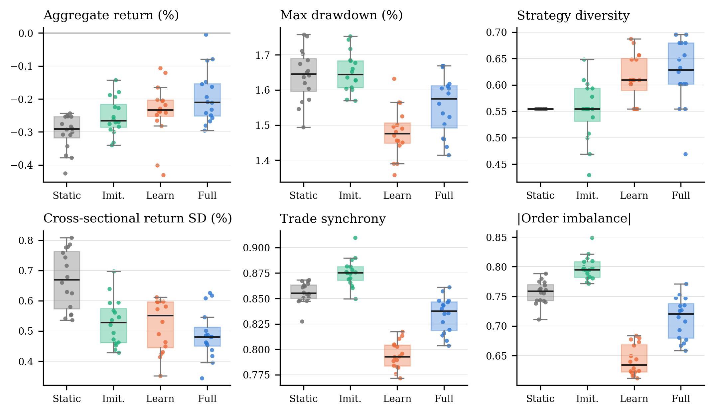
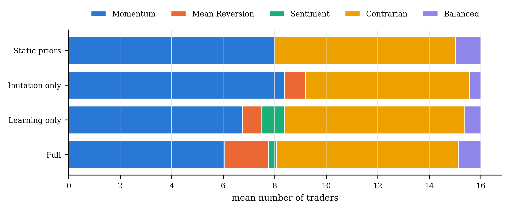
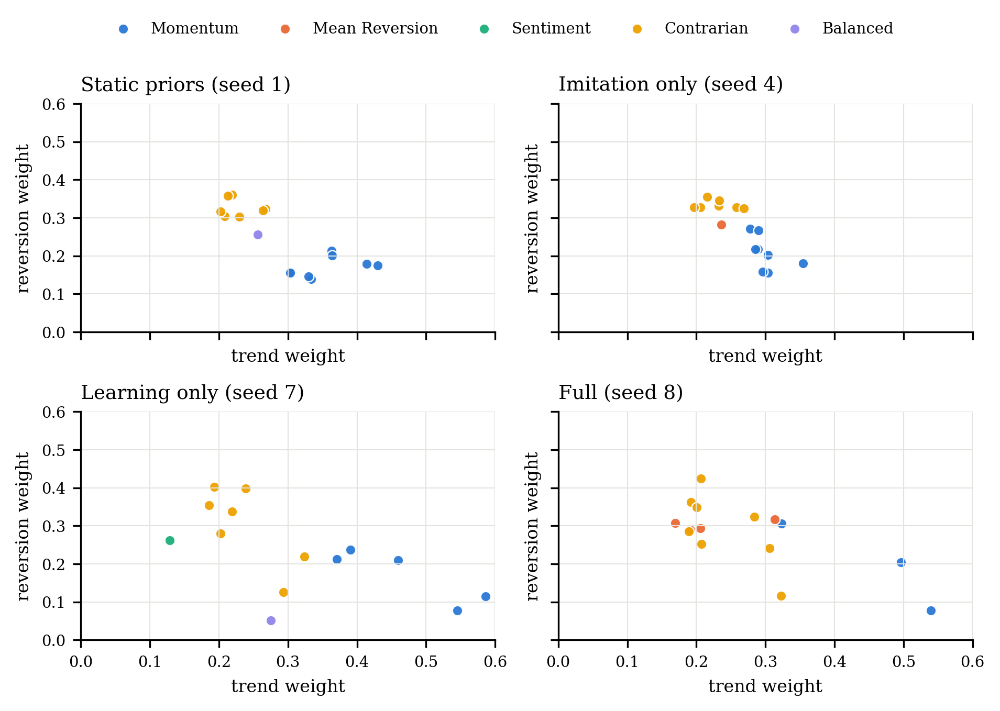
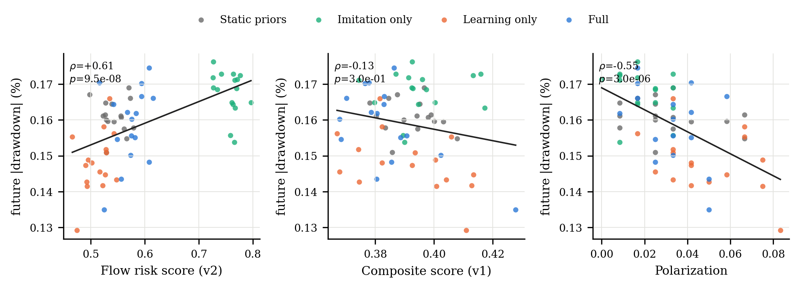

# Learning, Imitation, and Observer Validity in Agent Street

### A reproducible ablation study on a frozen real-market replay

**Code and data:** <https://github.com/huiihao/agent-street>  
**Snapshot SHA-256:** `3c9cf0ff864b68e6886c1f3181f67e6e93dbacef8102007c34fedc768c9f86fe`

---

## Abstract

We study an agent-based market simulation in which sixteen MBTI-flavoured traders evolve
interpretable strategy genomes through reward learning, imitation, and mutation, while four
observer agents publish structured reports. Using a frozen five-day, five-minute yfinance
snapshot and a four-condition × sixteen-seed ablation (64 runs, 300 ticks each), we find that
**reward learning reduces trade synchrony and order-flow imbalance, lowers cross-sectional
return dispersion, increases strategy diversity, and improves returns and drawdowns relative
to fixed priors**. **Imitation increases coordination**: adding it to learning raises synchrony and
worsens drawdown relative to learning alone without a significant return gain, while
imitation alone improves returns relative to static priors but does not improve drawdown
or strategy diversity. The population's guild composition shifts from a
momentum/contrarian split toward a broader ecology that includes mean-reversion and
sentiment strategies.

We then audit the observer agents. The original composite cascade-risk score is **not
predictive** of future synchrony, imbalance, or drawdown, and its polarization term points in
the opposite direction from its risk label: polarization behaves as a disagreement buffer.
A revised, order-flow-based observer score predicts future synchrony (Spearman ρ = 0.75),
absolute order imbalance (ρ = 0.77), and future drawdown magnitude (ρ = 0.61) at the run
level. The snapshot is validated against the source endpoint with exact bar-level agreement,
21 unit tests pass, and all 64 runs satisfy the wealth invariant. We discuss the tension
between individual learning and social imitation, the need to validate observer metrics
component-wise, and the limits of a single-market-regime study.

---

## 1. Objectives

1. Does individual reward learning change strategy diversity and market behaviour?
2. Does social imitation change coordination, guild composition, and performance?
3. Are the observer agents' reports quantitatively valid and predictive?
4. Are the data, accounting, and interaction mechanisms reliable enough to support the
   conclusions?

The experiment is deliberately **not** a claim about real-world alpha. The House market maker
pins the town price to the replay price, so agent behaviour cannot alter market returns; this
isolates the behavioural and accounting effects of learning and imitation.

---

## 2. System under test

Agent Street is a reproducible agent-based market diorama:

- **Market data**: one aligned, validated, cached bar timeline. The replay starts after 30
  warm-up bars and advances one bar per tick.
- **Traders**: 16 agents with MBTI-derived priors. A strategy genome contains six signal
  weights (trend, reversion, RSI, herding, influence, memory; sum = 1) and four traits
  (risk, patience, contrarian, noise).
- **Learning**: every buy carries its entry signal context. When a position closes, the
  realised trade return produces a reward and the genome is updated:
  `Δw_signal = η · reward · entry_signal`, with `reward = clip(trade_return / 2%, -1, 1)`.
  Risk and patience are adapted; wins/losses and an EMA fitness are tracked.
- **Imitation**: after a conversation, a lower-fitness trader may copy a blend of a
  higher-fitness playbook, gated by the trust graph. The Quant Lab raises the learning rate
  (1.7×) and the Guild Hall slightly raises imitation probability.
- **Mutation**: every 20 ticks a small fraction of genomes explore a random variation.
- **Matching**: limit checks, price/time priority, partial fills, direct crosses, and House
  absorption at real price ± half-spread. Fees are charged per side; buys capitalise fees
  into average cost; sells realise P&L; the wealth invariant is checked every 20 ticks.
- **Observers**: Physicist (order parameters, dispersion), Mathematician (trust graph,
  partitions), Social Engineer (trust density, polarization, guilds, order flow, cascade
  risk), Mystic (unvalidated colour). Reports are generated every 20 ticks.
- **UI**: a Three.js town, candles/compare/guilds views, Account/Strategy tabs, four observer
  cards, leaderboard and tape. The UI is not used in the experiment; the headless runner
  exercises the same engine.

---

## 3. Data provenance and reliability

### 3.1 Frozen snapshot

| Property | Value |
|---|---|
| Source | yfinance (Yahoo) |
| Snapshot file | `experiments/data/market_snapshot_5m_5d.json` |
| SHA-256 | `3c9cf0ff864b68e6886c1f3181f67e6e93dbacef8102007c34fedc768c9f86fe` |
| Interval | 5 minutes |
| Symbols | AAPL, GOOGL, MSFT, TSLA, AMZN |
| Aligned bars | 390 |
| Sessions | 2026-10-13, 14, 15, 16, 19 (UTC dates) |
| First / last bar | 2026-10-13T13:30Z / 2026-10-19T19:55Z |
| Cache created | 2026-10-20T08:11:01Z |

Validation on the snapshot:

- 390 aligned bars for every symbol;
- timestamps strictly monotonic, zero duplicates;
- zero non-positive prices, zero OHLC inconsistencies, zero negative volumes;
- one timestamp intersection index shared by all symbols.

### 3.2 Independent endpoint cross-check

Immediately after freezing, every symbol was re-fetched from the Yahoo chart endpoint for the
same window. All 390 overlapping bars matched exactly:

| Symbol | Common bars | Missing in remote | Extra remote | Max relative close difference |
|---|---:|---:|---:|---:|
| AAPL | 390 | 0 | 1 (post-snapshot) | 0.0 |
| GOOGL | 390 | 0 | 1 | 0.0 |
| MSFT | 390 | 0 | 1 | 0.0 |
| TSLA | 390 | 0 | 1 | 0.0 |
| AMZN | 390 | 0 | 1 | 0.0 |

The cross-check uses the same Yahoo upstream as yfinance; it verifies that the frozen snapshot
was not corrupted between fetch and experiment, not that Yahoo is an independent price source.
No independent intraday vendor was available for this study.

### 3.3 Execution reliability

- No network access during a run: the provider loads the frozen snapshot.
- LLM disabled; all behaviour is rule-based and deterministic under a seed.
- 21 unit tests cover bar cleaning/alignment, cache, indicators, matching, fees, partial
  fills, average cost, realised P&L, close events, win rate, wealth conservation, and strategy
  updates.
- 64 experiment runs × 300 ticks:
  - **0 wealth-invariant failures**;
  - all strategy signal weights sum to 1 within 1e-6;
  - all sampled trust edges are symmetric;
  - all conversation participants are valid traders;
  - all trades have positive shares and prices;
  - all recorded tick metrics are finite;
  - exactly 16 traders and 4 observers per frame.
- Determinism check: changing the observer's report logic (v1 → v2) left every agent-level
  metric bit-identical across all 64 runs; observers do not feed back into trading.

---

## 4. Experimental design

### 4.1 Conditions

| Condition | P&L weight learning | Imitation | Mutation | Purpose |
|---|:---:|:---:|:---:|---|
| Static priors | ✗ | ✗ | ✗ | Control: fixed MBTI genome |
| Imitation only | ✗ | ✓ | ✓ | Imitation without individual weight learning; fitness is still tracked from closes |
| Learning only | ✓ | ✗ | ✓ | Individual learning without social transmission |
| Full | ✓ | ✓ | ✓ | Complete system |

### 4.2 Protocol

- **Seeds**: 1–16 per condition (64 runs).
- **Horizon**: 300 ticks per run; the replay starts at bar 30 and does not loop.
- **Market path**: identical frozen bars for all runs; only agent decisions differ.
- **Metrics per tick**: aggregate return, fees, order flow (buy/sell shares and agents),
  trade synchrony, absolute order imbalance, strategy diversity, guild counts, generation,
  adaptations, trust density, observer reports and structured observer data.
- **End of run**: per-agent genome, generation, fitness, equity, realised/unrealised P&L,
  max drawdown, win rate, closed trades, positions.
- **Statistics**: paired Wilcoxon signed-rank tests blocked by seed; Holm correction within
  the six primary outcomes for each contrast; paired bootstrap (5,000 resamples) for mean
  differences; rank-biserial effect sizes. Observer predictive tests use run-level Spearman
  correlations with 5,000 run-cluster bootstrap resamples (report-level correlations are
  reported as a secondary view).
- **Primary outcomes**: aggregate return, max drawdown magnitude, strategy diversity,
  cross-sectional return SD, trade synchrony, absolute order imbalance.
- **Manipulation check**: strategy generation and adaptation count.

### 4.3 Definitions

- **Trade synchrony** at tick `t`: `max(#buy agents, #sell agents) / #trading agents`.
  Values near 1 mean the active traders are on one side.
- **Absolute order imbalance**: `|buy shares − sell shares| / (buy shares + sell shares)`.
- **Strategy diversity**: `1 − Σ (guild_count / 16)²`.
- **Max drawdown**: the most negative peak-to-trough equity drawdown over the run; we report
  its magnitude.
- **Future drawdown magnitude**: over the 20 ticks after an observer report, the absolute
  value of the minimum aggregate equity change relative to the report tick.
- **Observer run-level correlation**: each run's mean observer score and mean future outcome
  are computed first; the correlation is across 64 runs. This avoids pseudo-replication from
  overlapping 20-tick windows.

---

## 5. Results

### 5.1 Manipulation check

| Condition | Strategy generation (mean ± SD) | Adaptations (mean ± SD) |
|---|---:|---:|
| Static priors | 0.00 ± 0.00 | 0.0 ± 0.0 |
| Imitation only | 8.75 ± 1.81 | 36.8 ± 5.7 |
| Learning only | 78.25 ± 5.39 | 612.6 ± 20.5 |
| Full | 75.69 ± 7.78 | 607.8 ± 28.5 |

The conditions behave as intended. Learning produces many more updates than imitation alone;
mutation contributes a small number of exploration events.

### 5.2 Primary outcomes

| Condition | Aggregate return (%) | Max DD (%) | Strategy diversity | Return SD (%) | Trade synchrony | \|Order imbalance\| |
|---|---:|---:|---:|---:|---:|---:|
| Static priors | −0.302 ± 0.053 | 1.642 ± 0.074 | 0.555 ± 0.000 | 0.671 ± 0.098 | 0.856 ± 0.011 | 0.756 ± 0.019 |
| Imitation only | −0.252 ± 0.056 | 1.651 ± 0.056 | 0.553 ± 0.055 | 0.529 ± 0.077 | 0.875 ± 0.014 | 0.798 ± 0.020 |
| Learning only | −0.237 ± 0.084 | 1.479 ± 0.071 | 0.615 ± 0.045 | 0.519 ± 0.086 | 0.794 ± 0.013 | 0.642 ± 0.026 |
| Full | −0.192 ± 0.082 | 1.558 ± 0.084 | 0.624 ± 0.062 | 0.488 ± 0.079 | 0.834 ± 0.017 | 0.713 ± 0.035 |


*Figure 1. Twenty-tick rolling means with 95% confidence intervals across 16 seeds.
Learning raises strategy diversity and generation and reduces synchrony; imitation alone
raises synchrony and leaves diversity near the static baseline.*



*Figure 2. Primary outcomes by condition. Points are individual seeds.*

### 5.3 Paired contrasts

Mean difference `[95% bootstrap CI]`, with Holm-adjusted p for the six primary outcomes.

| Outcome | Full − Static | Learning − Static | Imitation − Static | Full − Learning |
|---|---|---|---|---|
| Aggregate return (pp) | **+0.110 [0.062, 0.166]**, p=.003 | **+0.065 [0.022, 0.104]**, p=.018 | **+0.050 [0.017, 0.087]**, p=.032 | +0.045 [0.002, 0.090], p=.536 |
| Max DD magnitude (pp) | **−0.084 [−0.133, −0.032]**, p=.008 | **−0.163 [−0.204, −0.118]**, p<.001 | +0.009 [−0.022, 0.039], p=.751 | **+0.079 [0.035, 0.125]**, p=.021 |
| Strategy diversity | **+0.069 [0.038, 0.097]**, p=.008 | **+0.060 [0.039, 0.081]**, p=.004 | −0.002 [−0.029, 0.023], p=1.0 | +0.009 [−0.027, 0.045], p=.842 |
| Return SD (pp) | **−0.183 [−0.245, −0.118]**, p=.002 | **−0.151 [−0.216, −0.092]**, p=.002 | **−0.141 [−0.207, −0.075]**, p=.005 | −0.032 [−0.077, 0.010], p=.645 |
| Trade synchrony | **−0.022 [−0.032, −0.012]**, p=.004 | **−0.061 [−0.071, −0.051]**, p<.001 | **+0.020 [0.012, 0.028]**, p<.001 | **+0.040 [0.031, 0.049]**, p<.001 |
| \|Order imbalance\| | **−0.043 [−0.062, −0.024]**, p=.003 | **−0.114 [−0.132, −0.095]**, p<.001 | **+0.041 [0.029, 0.054]**, p<.001 | **+0.071 [0.054, 0.089]**, p<.001 |

**Learning effects.** Relative to fixed priors, both learning conditions reduce trade
synchrony and order-flow imbalance, increase strategy diversity, reduce cross-sectional
return dispersion, and improve aggregate returns and drawdowns. These effects are
statistically robust across seeds, although the economic magnitudes are small: the return
difference is about 0.07–0.11 percentage points over the 300-tick window and the drawdown
difference is 0.08–0.16 percentage points.

**Imitation effects.** Adding imitation to learning raises synchrony and order-flow
imbalance substantially, does not significantly improve aggregate return, and significantly
worsens max drawdown relative to learning alone. Imitation alone raises synchrony and returns
relative to static priors but does not improve drawdowns or diversify guild composition.
The complete system has the best aggregate return but not the lowest coordination or
drawdown; there is a real tension between social transmission and diversification.

### 5.4 Strategy guilds

| Condition | Momentum | Mean reversion | Sentiment | Contrarian | Balanced |
|---|---:|---:|---:|---:|---:|
| Static priors | 8.000 | 0.000 | 0.000 | 7.000 | 1.000 |
| Imitation only | 8.375 | 0.812 | 0.000 | 6.375 | 0.438 |
| Learning only | 6.750 | 0.750 | 0.875 | 7.000 | 0.625 |
| Full | 6.062 | 1.688 | 0.312 | 7.062 | 0.875 |



*Figure 3. Mean guild composition. Learning creates mean-reversion and sentiment niches;
imitation alone mostly reshuffles the existing momentum/contrarian/balanced split.*



*Figure 4. Final genomes (trend vs reversion weights) for the seed nearest the condition's
median diversity. Static priors occupy two tight clusters; learning spreads the population
into new regions; the full system combines spread with imitation-driven local clustering.*

### 5.5 Observer audit

We compare the original Social Engineer composite score (v1: dominant share + polarization +
low trust density) with a flow-based score (v2):

```
flow_risk = 0.55·trade_synchrony + 0.25·min(1, imitation_events/3)
          + 0.20·dominant_share − 0.15·polarization
```

The v2 observer report uses order-flow alignment, imitation, and polarization as a
disagreement buffer. Both scores are evaluated against the **next 20 ticks** after each
report; the primary analysis aggregates each run first (n=64).

| Predictor | Future synchrony | Future \|order imbalance\| | Future \|drawdown\| |
|---|---:|---:|---:|
| v1 composite cascade score | ρ=0.029, p=.82 | ρ=0.044, p=.73 | ρ=−0.133, p=.30 |
| v2 flow-risk score | **ρ=0.754**, p=6.5e−13 | **ρ=0.769**, p=1.1e−13 | **ρ=0.609**, p=9.5e−08 |
| Flow synchrony | ρ=0.673, p=1.1e−09 | ρ=0.673, p=1.1e−09 | ρ=0.492, p=3.6e−05 |
| Flow imbalance | ρ=0.710, p=5.1e−11 | ρ=0.711, p=4.4e−11 | ρ=0.474, p=7.6e−05 |
| Imitation events | ρ=0.585, p=3.8e−07 | ρ=0.623, p=3.9e−08 | ρ=0.526, p=8.1e−06 |
| Polarization | ρ=−0.556, p=1.8e−06 | ρ=−0.540, p=4.2e−06 | ρ=−0.546, p=3.0e−06 |



*Figure 5. Run-level observer validation. The v1 composite is uninformative and its
polarization sign is reversed relative to the risk label; the v2 flow-based score tracks
future drawdown magnitude. Each point is one run mean; regression lines are shown.*

The v1 score is not merely uninformative: at the report level it is **negatively** associated
with future drawdown magnitude (ρ=−0.170, p=1.2e−07), because it treats polarization as a
risk factor while polarization behaves as a disagreement buffer. The v2 score reverses this
and is positively associated with future drawdown at both run (ρ=0.609) and report
(ρ=0.095, p=.003) levels. Report-level correlations are weaker than run-level correlations
because most of the between-run variance is averaged away; this is the expected
pseudo-replication pattern and is why the run-level test is primary.

**Interpretation.** The audit shows that composite observer heuristics can be internally
coherent yet empirically mis-specified. The validated signal is not "disagreement"; it is
**order-flow alignment plus imitation**. The revised observer exposes that signal and treats
polarization as a buffer. The v2 score is post-hoc and should be pre-registered and tested on
independent windows before being treated as an early-warning system.

---

## 6. Discussion

1. **Individual learning de-synchronizes, social imitation synchronizes.** Reward learning
   gives agents differential experiences and pushes genomes apart; imitation pulls them back
   toward a shared playbook. The full system sits between the two and achieves the best
   aggregate return, but pays for coordination with a larger drawdown than learning alone.
2. **Diversity is not free.** The learning conditions increase strategy diversity and reduce
   cross-sectional return dispersion; imitation alone leaves diversity unchanged and increases
   coordinated flow. Diversity here is a structural property, not automatically a virtue for
   performance.
3. **Observers need component-level validation.** The original composite looked reasonable
   (dominant narrative + polarization + sparse trust) but failed; its polarization component
   had the wrong sign. A flow-based score derived from the audit works much better in this
   window. This is a caution for LLM or agent observers whose reports are consumed as
   narratives: evaluate the scalars against outcomes, not just their prose.
4. **Economic magnitudes are small.** The market window is a single declining regime; returns
   differ by tenths of a percentage point and drawdowns by similar amounts. The statistically
   robust effects are behavioural (synchrony, diversity, dispersion), not claims of
   profitability.

---

## 7. Limitations

- **Single window, single regime.** The snapshot covers five sessions (2026-10-13 to
  2026-10-19) and ends in a declining market. The results may not generalise across regimes,
  horizons, or asset classes.
- **No market impact by design.** The House pins the town price to the replay; agents cannot
  move prices. This isolates behaviour but removes the endogenous price feedback that real
  agent-based markets often study.
- **Long-only, five US large caps, 5-minute bars.** No shorting, options, borrow costs, or
  volume constraints; fees and spread are fixed.
- **Observer v2 is post-hoc.** It was motivated by the v1 audit on the same 64 runs. The
  run-level correlation is strong but not a pre-registered out-of-sample validation.
- **Data source.** The snapshot is yfinance; the cross-check uses the same Yahoo upstream.
  An independent intraday vendor was not available, so the data are verified for integrity
  and consistency, not against a second independent provider.
- **Rule-based observers/traders.** LLM enrichment was disabled. LLM-powered agents may show
  different dynamics and observer behaviour.
- **No claim of alpha.** The system is a behavioural simulation; the returns are not an
  investment strategy or financial advice.

---

## 8. Reproducibility

```bash
# from the repository root
pip install -r experiments/requirements.txt
python experiments/run_experiment.py       # 64 runs, ~40-60 s
python experiments/analyze_results.py      # tables + figures + results.json
python -m unittest discover -s tests -v    # 21 unit tests
```

Artifacts:

- `experiments/data/market_snapshot_5m_5d.json` — frozen aligned bars;
- `experiments/data/snapshot_metadata.json` — provenance, validation, cross-check;
- `experiments/results/` — v2 tick/agent/observer/trust CSVs, run summary, reliability;
- `experiments/results_v1/` — v1 observer reports used for the audit;
- `experiments/results/tables/` — condition means, paired tests, guilds, observer correlations;
- `experiments/figures/` — PDF/PNG figures;
- `paper/` — arXiv-style LaTeX source and figures.

The experiment seed controls agent decisions and interactions. The market path is fixed, so
all conditions see the same prices and time stamps; differences are attributable to the
strategy mechanisms, subject to the stochastic agent seed.

---

## 9. Conclusion

In a controlled replay of real market bars, individual reward learning made the population
more diverse and less coordinated, and improved downside outcomes relative to fixed MBTI
priors. Adding social imitation to learning increased coordination and did not
significantly improve returns; the combination produced the best aggregate return but a
worse drawdown than learning alone. Imitation alone improved returns relative to static
priors but not drawdown or diversity.
The observer audit showed that a plausible composite risk narrative can fail, while an
order-flow-based signal predicts future synchrony and drawdown. The results argue for
treating agent-based market simulations as behavioural laboratories: report behavioural
metrics, validate observer scalars against outcomes, and avoid mistaking narrative coherence
for predictive validity.
