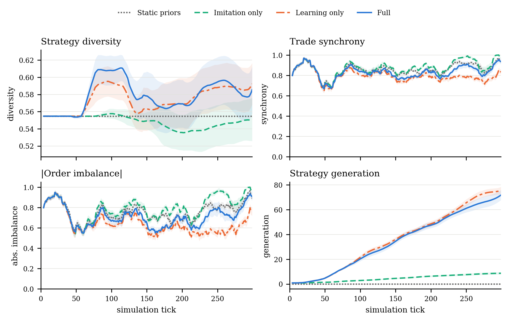
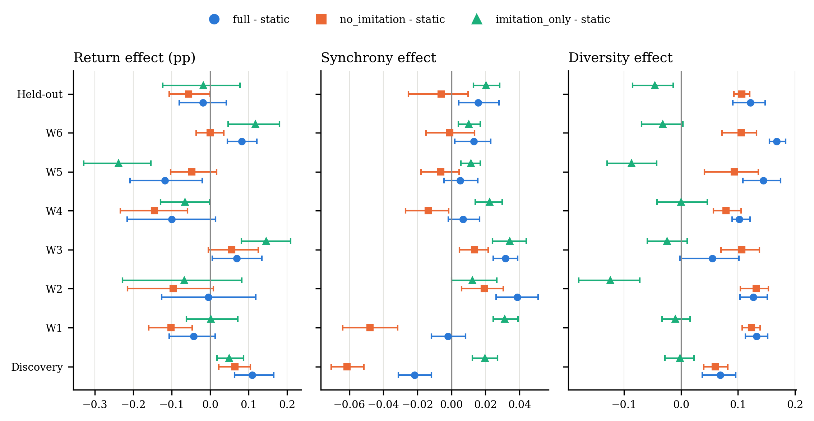
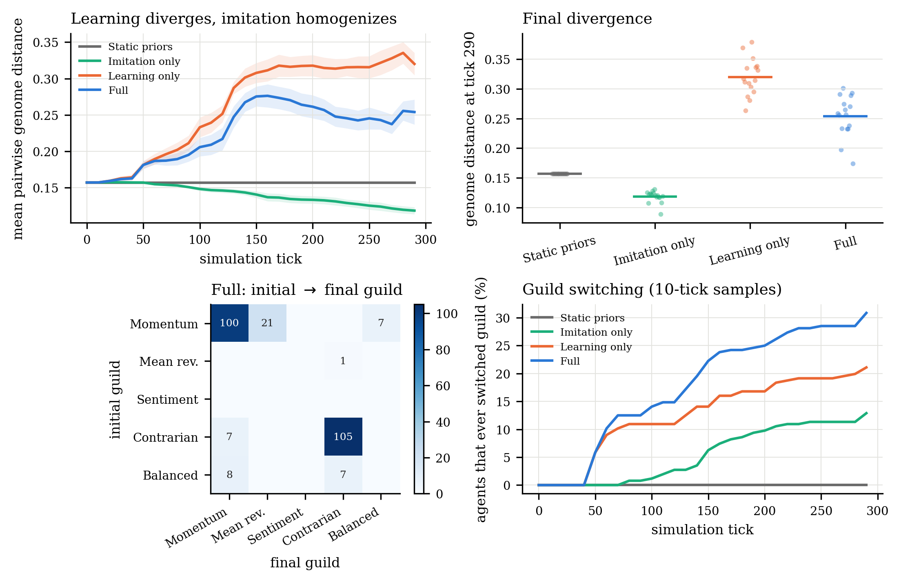
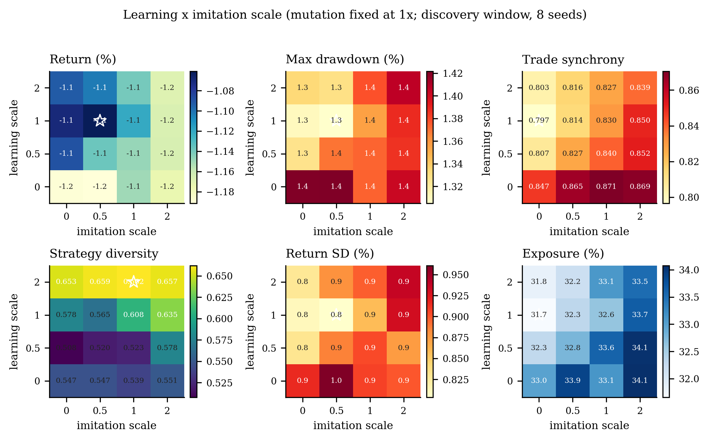
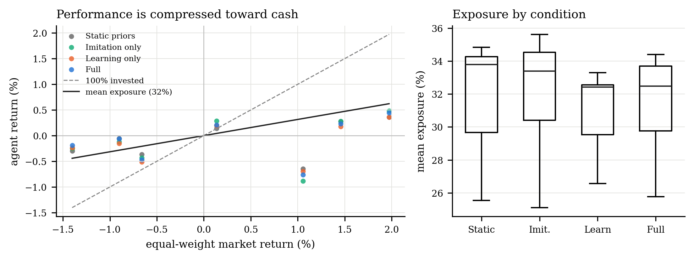
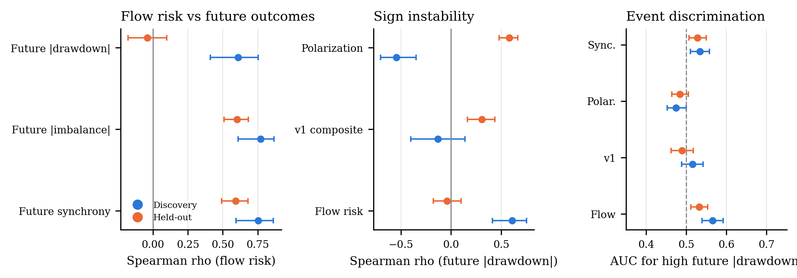
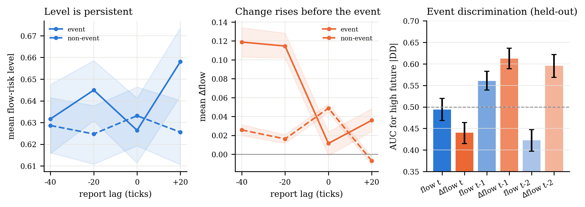
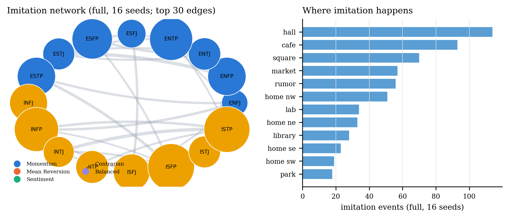

# Learning to Diverge, Imitating to Coordinate

### A multi-window replication and observer audit of an agent-based market

**Code and data:** <https://github.com/huiihao/agent-street>  
**Discovery snapshot SHA-256:** `3c9cf0ff864b68e6886c1f3181f67e6e93dbacef8102007c34fedc768c9f86fe`  
**Paper:** [`../paper/main.tex`](../paper/main.tex)

---

## Abstract

We study whether a population of evolving agents learns from its own trading experience and
from others, and whether observer agents can turn the resulting collective state into a useful
risk signal. Agent Street combines a validated five-symbol, five-minute market replay with
sixteen MBTI-flavoured traders whose strategy genomes adapt through reward-modulated learning,
trust-gated imitation, and mutation, plus four observers.

We use one discovery window and six held-out windows spanning up-, down-, and high-volatility
conditions, four mechanism conditions, 256 base runs, and a 128-run learning × imitation sweep.
The data are frozen and exhaustively validated; all 384 runs satisfy the accounting invariant.

The discovery window reproduces a familiar story: relative to static priors, learning improves
returns and drawdowns and de-synchronizes trading, whereas imitation coordinates. The held-out
windows separate robust from fragile claims. **Learning robustly increases strategy diversity
and signal-genome divergence** (final pairwise distance 0.320 vs. 0.157 for static; diversity
+0.107), and **imitation robustly increases order-flow coordination** (synchrony +0.020,
|imbalance| +0.041; 90–98% of paired observations). The discovery-window performance advantage
**does not replicate**: full minus static returns are −0.019 percentage points (p = .56) and
drawdowns are 0.034 pp larger (p = .15), while learning-only is 0.056 pp worse (p = .005).
Agents hold only about 32% exposure, and an equal-weight market benchmark explains most of the
variation; there is no alpha claim.

A learning × imitation phase map shows that coordination rises monotonically with imitation,
while return and drawdown are best at moderate imitation (1× learning, 0.5× imitation) and
deteriorate at high imitation.

The observer audit is similarly cautionary. The original composite cascade score is
uninformative; a flow-based score predicts future coordination both in and out of sample
(ρ = .59–.60), but its discovery-window drawdown signal (ρ = .61; run-level AUC .81) reverses
out of sample (ρ = −.04; AUC .44), and an event-level AUC is only .53. Polarization's sign flips
across windows. A target-specific follow-up separates the sensors: the Physicist is a
between-window volatility descriptor, the Mathematician tracks trust structure, the Social
Engineer's flow level ranks runs but not events, and the Mystic is a placebo. The flow change
20 ticks earlier has a modest event-level AUC of .61 (five of six windows) but no run-level
signal — a candidate timing signal, not a validated warning. The robust results are behavioural —
**learning diverges, imitation coordinates** — while single-window performance and observer-
warning claims are fragile. Observer scores must be validated on the outcome they claim to
predict, across held-out windows, at both run and event levels, with levels and changes reported
separately.

---

## 1. Objectives

1. Does individual reward learning change strategy diversity, genome divergence, coordination,
   and performance?
2. Does social imitation change coordination, guild lineage, and performance?
3. Do these behavioural effects replicate across independent market windows?
4. Do the observer agents' structured metrics predict future coordination or drawdown, and do
   those predictions survive out of sample?
5. Are the data, accounting, and interaction mechanisms reliable enough to support the
   conclusions?

The experiment is deliberately **not** a claim about real-world alpha. The House market maker
pins the town price to the replay price, agents are long-only and cash-heavy, and the market
path is exogenous. The design isolates behavioural and accounting effects.

---

## 2. System under test

- **Market data**: a single aligned, validated, cached 5-minute bar timeline per window. The
  replay starts after 30 warm-up bars and advances one bar per tick.
- **Traders**: 16 agents with MBTI-derived priors. A strategy genome contains six signal
  weights (trend, reversion, RSI, herding, influence, memory; sum = 1) and four traits
  (risk, patience, contrarian, noise). Decisions combine trend, mean reversion, RSI, herding,
  social influence, and memory; risk controls include drawdown panic, stop loss, profit
  taking, holding periods, position caps, and symbol cooldowns.
- **Learning**: every buy carries its entry signal context. When a position closes, the
  realised return produces a reward and the genome is updated:
  `Δw_signal = η · reward · entry_signal`, with
  `reward = clip(trade_return / 2%, −1, 1)`. Risk and patience adapt; wins/losses and an EMA
  fitness are tracked. The Quant Lab raises the learning rate (1.7×).
- **Imitation**: after a conversation, a lower-fitness trader may copy a blend of a
  higher-fitness playbook, gated by the trust graph. The Quant Lab slightly raises imitation
  probability and the Guild Hall raises it through social co-location. Imitation is a
  trust- and fitness-gated blend, not a global broadcast.
- **Mutation**: every 20 ticks a small fraction of genomes explore a random variation.
- **Matching**: limit checks, price/time priority, partial fills, direct crosses, and House
  absorption at real price ± half-spread. Fees are charged per side; buys capitalise fees
  into average cost; sells realise P&L; the wealth invariant is checked every 20 ticks.
- **World**: 15 locations on a road grid, daily routines with BFS pathfinding, conversations
  requiring co-location, and a trust network. The Guild Hall, Rumor Mill, and Quant Lab are
  social hubs added for this study.
- **Observers**: Physicist (order parameters, dispersion), Mathematician (trust graph,
  partitions), Social Engineer (trust density, polarization, guilds, order flow, flow
  alignment), Mystic (unvalidated colour). Reports are generated every 20 ticks and expose
  structured metrics alongside prose. The experiments use the structured fields, not the
  prose.
- **UI**: a Three.js town, candles/compare/guilds views, Account/Strategy tabs, four observer
  cards, leaderboard and tape. The UI is not used in the experiment; the headless runner
  exercises the same engine.

The two Social Engineer scores are:

```
v1 = 0.45·D + 0.35·P + 0.20·(1 − min(1, trustDensity/0.25))
v2 = 0.55·S + 0.25·min(1, imitationRecent/3) + 0.20·D − 0.15·P
```

where `D` is dominant guild share, `P` polarization, `S` trade synchrony. v2 is fixed before
the held-out evaluation; it is not re-fitted.

---

## 3. Data provenance

Seven snapshots are frozen and used without network access. Each contains 390 aligned 5-minute
bars for AAPL, GOOGL, MSFT, TSLA, and AMZN over five sessions. The first 30 bars are warm-up;
the experiment then runs 300 ticks. The discovery window is 2026-10-13 to 2026-10-19; the six
held-out windows are 2026-08-24 to 2026-10-09.

| Window | Dates (UTC) | Market return | Max DD | Volatility | Role |
|---|---|---:|---:|---:|---|
| Discovery | 2026-10-13 to 2026-10-19 | −1.40% | 4.20% | 18.6% | Discovery |
| W1 | 2026-08-24 to 2026-08-28 | +1.46% | 1.59% | 15.4% | Held out |
| W2 | 2026-08-31 to 2026-09-04 | −0.90% | 3.20% | 26.6% | Held out |
| W3 | 2026-09-14 to 2026-09-18 | +0.14% | 2.74% | 20.2% | Held out |
| W4 | 2026-09-21 to 2026-09-25 | −0.66% | 2.90% | 14.3% | Held out |
| W5 | 2026-09-28 to 2026-10-02 | +1.06% | 1.86% | 23.2% | Held out |
| W6 | 2026-10-05 to 2026-10-09 | +1.97% | 1.33% | 14.1% | Held out |

Returns, drawdowns, and volatilities are computed over the 300-tick experiment segment
(bars 30–329); volatility is annualised from the equal-weight market return. Every snapshot
has five sessions, five symbols, and 390 aligned bars. All 35 symbol-windows were re-fetched
from the Yahoo chart endpoint; every overlapping close matched exactly (maximum relative
difference 0.0). Each snapshot has a SHA-256 in its `snapshot_metadata.json`.

The discovery window is the only window used to motivate the mechanisms and the v2 observer.
The six held-out windows are not used to fit the strategies, the phase map, or v2. They span a
strong up week (W6), a down/high-volatility week (W2), and mixed conditions.

---

## 4. Experimental design

### Conditions

| Condition | P&L learning | Imitation | Mutation | Purpose |
|---|---|---|---|---|
| Static priors | no | no | no | Fixed MBTI genome (control) |
| Imitation only | no | yes | yes | Social transmission without weight learning |
| Learning only | yes | no | yes | Individual learning only |
| Full | yes | yes | yes | Complete system |

### Runs

- **Discovery**: 4 conditions × 16 seeds × 300 ticks = 64 runs.
- **Held-out**: 6 windows × 4 conditions × 8 seeds × 300 ticks = 192 runs.
- **Phase sweep**: 4 learning scales (0, 0.5, 1, 2) × 4 imitation scales (0, 0.5, 1, 2) ×
  8 seeds × 250 ticks = 128 runs. Mutation is fixed at 1×.
- **Total**: 384 runs.

The market path is identical across conditions within a window; only agent decisions and
interactions differ. LLM enrichment is disabled; experiments read no network.

### Outcomes

Primary: aggregate return, max drawdown magnitude, strategy diversity (1 − HHI of guild
counts), cross-sectional return SD, trade synchrony (larger buy/sell agent count divided by
trading agents), absolute order imbalance. Secondary: mean exposure, turnover, final
signal-genome distance (mean pairwise Euclidean distance over the six normalized signal
weights), guild switching, and observer metrics.

### Statistics

- Discovery: paired Wilcoxon signed-rank tests blocked by seed, Holm correction within the
  six primary outcomes per contrast, paired bootstrap 95% CIs, rank-biserial effect sizes.
- Held-out: the same paired differences over 48 seed-window pairs; CIs resample windows with
  replacement (window-cluster bootstrap); p-values are raw because this is a planned
  replication. Sign counts expose heterogeneity.
- Observer: run-level Spearman correlations (one observation per run), 3,000 run-cluster
  bootstrap resamples; report-level correlations as a secondary view; run-level and
  event-level AUCs for high future |drawdown| (top quartile). Run-level AUC asks whether a
  run is risky; event-level AUC asks whether a report is an early warning.
- v2 is not re-fitted on held-out windows. The held-out evaluation is temporal and
  formula-fixed, not a pre-registered random sample.

---

## 5. Reliability

| Check | Result |
|---|---|
| Snapshots | 7 × 390 aligned bars; 5 symbols; 5 sessions |
| Endpoint cross-check | 35/35 symbol-windows exact; max relative difference 0.0 |
| Base runs | 64 discovery + 192 held-out = 256 |
| Phase sweep | 128 runs |
| Wealth invariant | 0 failures across all 384 runs |
| Genomes | all signal weights sum to 1 |
| Trust | all sampled edges symmetric |
| Conversations / trades | all participants valid; all shares and prices positive |
| Metrics | all recorded values finite |
| Agent-level observer feedback | v1→v2 change left every agent metric bit-identical |
| Unit tests | 21 passing (data, indicators, matching, accounting, strategy) |

---

## 6. Results

### 6.1 Discovery window: the familiar story

| Condition | Return | Max DD | Diversity | Return SD | Synchrony | \|Imbalance\| | Exposure | Genome distance |
|---|---:|---:|---:|---:|---:|---:|---:|---:|
| Static priors | −0.302% | 1.642% | 0.555 | 0.671 pp | 0.856 | 0.756 | 34.8% | 0.157 |
| Imitation only | −0.252% | 1.651% | 0.553 | 0.529 pp | 0.875 | 0.798 | 35.6% | 0.118 |
| Learning only | −0.237% | 1.479% | 0.615 | 0.519 pp | 0.794 | 0.642 | 32.6% | 0.320 |
| Full | −0.192% | 1.558% | 0.624 | 0.488 pp | 0.834 | 0.713 | 34.4% | 0.254 |

Relative to static priors, full improves return by +0.110 pp (Holm p = .003), reduces drawdown
by 0.084 pp (p = .008), raises diversity by +0.069 (p = .008), lowers return SD by 0.183 pp
(p = .002), and lowers synchrony by 0.022 (p = .004) and |imbalance| by 0.043 (p = .003).
Learning-only shows a larger drawdown reduction (0.163 pp, p < .001) and synchrony reduction
(0.061, p < .001). Imitation-only raises synchrony (+0.020) and imbalance (+0.041), improves
return by +0.050 pp, but does not improve drawdown or diversity. Adding imitation to learning
raises synchrony by +0.040 and imbalance by +0.071 (both p < .001), worsens drawdown by
0.079 pp (p = .021), and does not significantly improve return (Holm p = .536).



### 6.2 Multi-window replication: what survives



| Metric | Full − Static, discovery | Full − Static, held-out | Learning − Static, discovery | Learning − Static, held-out | Imitation − Static, discovery | Imitation − Static, held-out |
|---|---:|---:|---:|---:|---:|---:|
| Return (pp) | +0.110*** | −0.019 | +0.065* | −0.056** | +0.050* | −0.018 |
| Drawdown improvement (pp) | +0.084** | −0.034 | +0.163*** | −0.028* | −0.009 | −0.061** |
| Strategy diversity | +0.069** | +0.122*** | +0.060** | +0.107*** | −0.002 | −0.046*** |
| Trade synchrony | −0.022** | +0.016*** | −0.061*** | −0.006 | +0.020*** | +0.020*** |
| \|Order imbalance\| | −0.043** | +0.033*** | −0.114*** | −0.014 | +0.041*** | +0.041*** |

Discovery uses 16 seeds and Holm-adjusted p; held-out pools 48 seed-window pairs across six
windows with a window-cluster bootstrap. Stars: * p < .05, ** p < .01, *** p < .001 (held-out
raw; discovery Holm). The learning-only held-out drawdown difference is raw p = .047 and does
not survive Holm correction.

**Robust results.** Learning increases diversity by +0.107 (95% CI [.093, .121]) and the full
system by +0.122 ([.091, .147]); 94–96% of the 48 paired observations are positive (p < 1e−8).
Imitation increases synchrony by +0.020 ([.013, .028]) and |imbalance| by +0.041
([.030, .053]); 90% and 98% of paired observations are positive (p < 1e−10). The full system
is more coordinated than learning alone: synchrony +0.022, imbalance +0.047 (both p < 1e−8),
with a small return advantage (+0.037 pp, p = .038) but no drawdown advantage.

**Fragile results.** Full minus static return is −0.019 pp (95% CI [−.081, +.043], p = .56);
the drawdown improvement is −0.034 pp (drawdowns are 0.034 pp larger; p = .15). Learning-only
is 0.056 pp worse than static (p = .005) and its drawdown improvement is −0.028 pp (raw
p = .047, not Holm-corrected). Imitation-only is indistinguishable from static on return
(−0.018 pp, p = .79), raises coordination, and increases drawdown magnitude by 0.061 pp
(p = .005). The discovery-window signs for full-minus-static return and synchrony reverse:
+0.110 pp and −0.022 become −0.019 pp and +0.016. The full system's return advantage over
learning alone is real but small; it does not make the full system better than static priors on
average.

### 6.3 Strategy divergence and guild lineage



At tick 0 all conditions have the same mean pairwise signal-genome distance (0.157). Static
priors stay flat. Learning-only rises to 0.320; the full system rises to 0.254 (imitation pulls
it back); imitation-only falls to 0.118. Guild diversity tells a related but not identical
story: full 0.624, learning-only 0.615, imitation-only 0.553, static 0.555. The full system
keeps high guild diversity while reducing continuous genome distance: imitation helps agents
cross guild boundaries but also blends their playbooks.

At tick 300, 19.9% of full agents, 16.0% of learning-only agents, 10.6% of imitation-only
agents, and 0% of static agents have a different final guild; the fractions that ever switched
are 30.9%, 21.1%, 12.9%, and 0% (10-tick samples). The full system has the most lineage churn,
even though it is not the most genomically diverse.

### 6.4 The learning–imitation phase map



Coordination rises monotonically with imitation at every learning scale; learning lowers
synchrony at every imitation scale. Return and drawdown are non-monotone. At 1× learning,
return is best at 0.5× imitation (−1.061%) and deteriorates at 1× (−1.121%) and 2× (−1.167%);
drawdown magnitude follows the same ordering (1.305%, 1.355%, 1.388%). The best cell is
learning 1×, imitation 0.5×. Strategy diversity increases with learning (0.547 at 0× to
0.653–0.662 at 2×); at 1× learning it also increases with imitation (0.578 to 0.635),
reflecting guild mixing. Exposure falls modestly with learning (33.0% at zero learning to
32.3% at 0.5× and 31.7% at 1×) and rises slightly with imitation. Coordination is not
performance.

### 6.5 Exposure, benchmarks, and the missing alpha



The agents hold only about 32% of their equity in stocks on average; the rest is cash. The
equal-weight market return ranges from −1.40% (discovery) to +1.97% (W6). Agent returns are
compressed toward zero. In the discovery window the full system returns −0.19% while the market
returns −1.40%, but its exposure-implied return is about −0.48%; the difference is
timing/selection and fees, not a fully invested outperformance. In W5 the market rises +1.06%
while the full system loses −0.76% (exposure 33.7%), a large adverse residual. In W6 the market
rises +1.97% and the full system earns +0.45% (exposure 25.8%). The conditions differ by a few
tenths of a percentage point while the market moves by several percentage points. The agents
are cash-heavy and regime-sensitive; the small condition differences are not a robust alpha.

### 6.6 Observer audit

| Predictor | Future synchrony | Future \|imbalance\| | Future \|drawdown\| |
|---|---:|---:|---:|
| v2 flow, discovery | 0.754 | 0.769 | 0.609 |
| v2 flow, held-out | 0.592 | 0.603 | −0.041 (p = .58) |
| v1 composite, discovery | 0.029 | 0.044 | −0.133 |
| v1 composite, held-out | −0.039 | −0.059 | +0.305 |
| Polarization, discovery | −0.556 | −0.540 | −0.546 |
| Polarization, held-out | −0.206 | −0.213 | +0.580 |

| Predictor | Run AUC, discovery | Run AUC, held-out | Event AUC, discovery | Event AUC, held-out |
|---|---:|---:|---:|---:|
| v2 flow | 0.805 | 0.443 | 0.566 | 0.532 |
| v1 composite | 0.522 | 0.523 | 0.516 | 0.489 |
| Polarization | 0.283 | 0.733 | 0.475 | 0.484 |



On the discovery window the v1 composite is uninformative: run-level correlations with future
synchrony, |imbalance|, and |drawdown| are 0.029, 0.044, and −0.133 (p = .30 for drawdown).
Polarization is negatively associated with future |drawdown| (ρ = −0.546), the opposite of its
risk label. The v2 flow-risk score is strongly associated with future synchrony (ρ = .754),
|imbalance| (.769), and |drawdown| (.609); the run-level AUC for high future |drawdown| is .805.
This is the result that motivated a risk narrative.

The held-out windows separate prediction from persistence. The v2 flow score still predicts
future synchrony (ρ = .592) and |imbalance| (.603; p < 1e−18), so it is a genuine
coordination-persistence signal. Its correlation with future |drawdown| is −0.041 (p = .58),
and the run-level AUC for high future |drawdown| is .443 — below chance. The event-level AUC is
.532 (95% CI [.512, .554]), effectively no discrimination. The original composite's held-out
drawdown correlation is +0.305 and polarization's is +0.580; both have the opposite sign from
the discovery window. The component that looked protective in one window looks risky in
another, and the flow score that looked like an early warning in one window does not warn on the
others.

The practical lesson is not that observers are useless. The Physicist and Mathematician fields
are descriptive and useful; the flow score is a useful measure of order-flow alignment. A
scalar labelled "risk" must be validated against the outcome it claims to predict, on held-out
windows, at both run and event levels. A run-level correlation can be driven by between-run
heterogeneity; an event-level AUC asks whether a report is an early warning. The v2 *level* is
a coordination-persistence signal, not a validated crash warning. The application now labels
the field "flow-alignment risk" rather than "cascade risk".

### 6.7 Target-specific observer map and flow changes

The exploratory field scan treated each observer's metrics as possible risk signals. The formal
follow-up fixes one primary metric and one primary target per observer and evaluates them on the
held-out windows. Because the map was motivated by the discovery-window scan, the held-out
columns are a temporal out-of-sample check, not a fully pre-registered design.

| Observer / metric | Target | Discovery within | Held-out within | Held-out between | Partial | Reading |
|---|---|---:|---:|---:|---:|---|
| Physicist, avgVol | Future \|mkt return\| | −0.014 | −0.200*** | 0.943** (6 windows) | — | Between-window volatility regime; not a within-window forecast |
| Mathematician, broker degree | Future trust density | 0.768*** | 0.702*** | 0.698*** (192 runs) | 0.347*** | Trust-structure persistence / centrality |
| Social Engineer, flow risk | Future synchrony | 0.145*** | 0.094*** | 0.592*** (192 runs) | 0.441*** | Between-run coordination descriptor; level weak within-run |
| Mystic, sentiment | Future return | 0.144*** | −0.207*** | −0.578*** (192 runs) | — | Placebo / current-state persistence; sign flips |

"Within" is the report-level rank correlation after removing window means (n = 960 discovery,
2,880 held-out); "between" is the window-level correlation for the Physicist (six windows) or
the run-level correlation for the other observers (192 runs). The partial column controls the
Mathematician's current trust components and the Social Engineer's current flow synchrony.
Within-window p-values are autocorrelation-naive and descriptive. The Physicist's run-level
.94 is not an independent sample: it is a between-window volatility relation, while the
within-window relation is negative.

| Predictor | Report AUC | Run AUC | Windows > 0.5 |
|---|---:|---:|---:|
| flow t | 0.494 [0.469, 0.520] | 0.443 [0.339, 0.552] | 2/6 |
| Δflow t | 0.440 [0.415, 0.464] | 0.506 [0.400, 0.603] | 3/6 |
| flow t−1 | 0.561 [0.540, 0.583] | 0.444 [0.337, 0.553] | 5/6 |
| Δflow t−1 | **0.612 [0.589, 0.636]** | 0.499 [0.393, 0.602] | 5/6 |
| Δflow t−2 | 0.596 [0.569, 0.622] | 0.552 [0.453, 0.647] | 3/6 |

Event = a report whose next 20-tick agent-equity drawdown is in the top quartile. "Report" uses
one observation per report; "Run" uses one maximum future drawdown per run. The level at t is
not an event warning; the change one report earlier is a modest event-level lead, but the
run-level AUC is at chance. The level AUC is computed on the Δflow sample (the first report of
each run has no previous report), so it differs slightly from the observer-audit table; both
are near chance.

| Lag (ticks) | Event Δflow | Non-event Δflow | Event flow level | Non-event flow level |
|---:|---:|---:|---:|---:|
| −40 | 0.119 | 0.026 | 0.632 | 0.629 |
| −20 | 0.115 | 0.016 | 0.645 | 0.625 |
| 0 | 0.012 | 0.049 | 0.626 | 0.633 |
| +20 | 0.036 | −0.007 | 0.658 | 0.626 |

| Window | Δflow t−1 AUC | flow t−1 AUC | Event-minus-non Δflow |
|---|---:|---:|---:|
| W1 | 0.580 | 0.501 | +0.121 |
| W2 | 0.619 | 0.567 | +0.107 |
| W3 | 0.791 | 0.445 | +0.270 |
| W4 | 0.437 | 0.608 | −0.053 |
| W5 | 0.680 | 0.589 | +0.182 |
| W6 | 0.673 | 0.591 | +0.186 |



At the report whose next 20 ticks contain a top-quartile drawdown, flow t and Δflow t are
uninformative or below chance (AUC .494 and .440); one report earlier, flow t−1 reaches .561
and Δflow t−1 reaches .612 (95% CI [.589, .636]). The per-window count is five of six for both,
with W4 the exception (AUC .437); the run-level AUC for Δflow t−1 is .499. The event study
shows Δflow building from .026 to .119 at −40 ticks and from .016 to .115 at −20 ticks, then
collapsing to .012 at the event. The level is only slightly elevated before the event. The
pattern is a buildup of flow alignment before a drawdown window, not a persistent high level.

This is a modest, event-level timing signal, not a validated warning. It does not improve
run-level risk ranking, it has one window exception, and the effect size is small. It does show
why the level and the change must be reported separately: the level is a coordination state,
the change is a candidate early-warning derivative. A deployed observer should expose both,
and should be evaluated with held-out event-level AUCs rather than a single run-level
correlation.

### 6.8 The imitation network



| Condition | Events | Events/run | Effective teachers | Mean trust | Fitness gap | Guild change |
|---|---:|---:|---:|---:|---:|---:|
| Full | 596 | 37.3 | 14.0 | 0.118 | +0.0045 | 7.2% |
| Imitation only | 585 | 36.6 | 13.9 | 0.115 | +0.0044 | 10.4% |
| Learning only | 0 | 0 | — | — | — | — |
| Static priors | 0 | 0 | — | — | — | — |

All 16 agents appear as both teachers and learners in the full condition. Teacher concentration
is low (effective teachers 14.0 of 16), mean trust on an imitation edge is 0.118, and teachers
are slightly fitter than learners (+0.0045). Only 7.2% of full imitation events change the
learner's guild; imitation usually adjusts weights within a guild. The most common locations
are the Guild Hall (114 events), Morning Brew Cafe (93), Town Square (70), market (57), Rumor
Mill (56), and Quant Lab (34). Transmission is diffuse and embedded in the town's social
geography, not a single guru's broadcast.

---

## 7. Discussion

The central empirical pattern is a separation between behavioural mechanisms and economic
outcomes. Learning is a diversifying force: it gives agents different experiences, moves their
signal genomes apart, and raises guild diversity; the diversity and divergence results replicate
across all six held-out windows. Imitation is a coordinating force: it raises trade synchrony
and order-flow imbalance, and the effect replicates across all six held-out windows with high
sign consistency. The full system balances the two: more diverse than static priors, more
coordinated than learning alone. The phase map shows coordination can be increased
monotonically with imitation, while return and drawdown are best at moderate imitation.

The performance result is fragile. The discovery window is a down/high-volatility week;
learning and the full system lose less than static priors because they are cash-heavy, not
because they have a robust alpha. Across six held-out windows the full-minus-static return
difference is statistically indistinguishable from zero and the drawdown difference is slightly
negative. Learning-only actually underperforms static priors on average. The agents hold about
one third of their equity in stocks, so their returns are a compressed image of the market; the
condition differences are small relative to market moves.

The observer result is the sharpest caution. The v1 composite had a coherent narrative and
failed. The v2 flow score had a strong discovery-window drawdown correlation and a run-level AUC
of .81, but the correlation reversed on held-out windows and the run-level AUC fell to .44. The
flow score's coordination prediction survived (ρ ≈ .59–.60), which is exactly what a
coordination-persistence measure should do; it is not a crash warning. Polarization's sign
changed across windows. Observer research should report the outcome-specific, held-out,
run-level and event-level results, not only the in-sample correlation.

The target-specific follow-up makes the level/change distinction concrete. The flow level is a
between-run coordination state: it ranks runs (ρ = .59) but is weak within-run (ρ = .09) and
does not discriminate drawdown events (AUC .49). The change 20 ticks earlier is an event-level
signal (AUC .61, five of six windows) but is at chance at the run level (.50); it is a candidate
timing signal, not a risk rating. The Physicist's apparent .94 is a between-window volatility
relation, the Mathematician's .70 is trust-structure persistence, and the Mystic's sentiment is
a placebo whose sign flips. A useful observer dashboard should expose these as separate sensors
and should never collapse them into one "risk" number.

The imitation network adds a social-layer result. Transmission is diffuse: all sixteen agents
teach and learn, effective teacher concentration is low, and the fitness gap is small. The
town's geography matters: the Guild Hall, cafe, square, market, and Rumor Mill are the main
sites. Imitation usually adjusts weights within a guild; guild changes are rare. The full system
has more lineage churn than learning alone because imitation helps agents cross guild boundaries,
but it also compresses continuous genome distance.

---

## 8. Limitations

- **Seven windows, two months, five mega-caps.** The six held-out windows are not a random
  sample; they were chosen from the available 60-day five-minute history to span regimes. The
  discovery window is a down/high-vol week. Other assets, frequencies, and longer samples may
  differ.
- **Exogenous prices.** The House absorbs residual order flow, so the town price equals the
  replay price. This isolates behaviour but removes endogenous price impact, feedback, and
  liquidity effects.
- **Long-only, cash-heavy agents.** Five symbols, no shorting, leverage, options, borrow costs,
  or volume limits. Mean exposure is about 32%; the performance comparisons are not a test of a
  fully invested strategy.
- **Rule-based agents and observers.** The learning rule is a lightweight reward-modulated
  Hebbian update, not deep reinforcement learning; imitation is a fixed blend; observers are
  heuristics. LLM enrichment was disabled.
- **Post-hoc v2 and selected windows.** The v2 formula was motivated by the discovery-window v1
  failure. The held-out windows were not used to fit it, but they were fetched after the formula
  was fixed and selected by regime. The out-of-sample test is temporal and formula-fixed, not a
  pre-registered random sample.
- **Multiple comparisons.** The held-out tests are reported raw; the strong behavioural effects
  survive Holm correction, but the small performance differences should not be over-interpreted.
- **Post-hoc target map and modest lead.** The target-specific map was motivated by the
  discovery-window field scan; the held-out tests are temporal out-of-sample, not pre-registered.
  The Δflow lead is event-level, has one window exception (W4), and is at chance at the run
  level. It is a candidate for a pre-registered intervention, not a validated early-warning
  system.
- **Outcome definitions.** The run-level AUC uses one maximum future drawdown per run; the
  event-level AUC uses report-level 20-tick windows. Both answer useful questions but neither is
  a full early-warning evaluation with lead-time constraints.
- **No financial claim.** This is a simulation, not investment advice, and the returns are not
  an alpha claim.

---

## 9. Reproducibility

```bash
# Discovery window
python experiments/run_experiment.py --design base --ticks 300 \
  --seeds 1,2,3,4,5,6,7,8,9,10,11,12,13,14,15,16 \
  --out experiments/results

# Six held-out windows
for d in experiments/data/windows/w*; do
  name=$(basename "$d")
  python experiments/run_experiment.py --design base --ticks 300 \
    --seeds 1,2,3,4,5,6,7,8 \
    --snapshot "$d/market_snapshot_5m_5d.json" \
    --metadata "$d/snapshot_metadata.json" \
    --out "experiments/results_windows/$name"
done

# Learning x imitation sweep
python experiments/run_experiment.py --design sweep --ticks 250 \
  --seeds 1,2,3,4,5,6,7,8 \
  --learning-scales 0,0.5,1,2 --imitation-scales 0,0.5,1,2 \
  --out experiments/results_sweep

# Analysis and figures
python experiments/analyze_results.py
python experiments/analyze_extensions.py
python experiments/analyze_strategy.py
python experiments/analyze_observer_targets.py
python -m unittest discover -s tests -v
```

The experiments use no network. The frozen snapshots and their metadata are under
`experiments/data/`. The analysis writes `experiments/results/tables/` and
`experiments/figures/`.

---

## 10. Files

| File | Description |
|---|---|
| `experiments/results/` | Discovery run CSVs, run summary, observer reports, strategies, imitation events, tables, figures |
| `experiments/results_windows/` | Six held-out window runs |
| `experiments/results_sweep/` | 4×4 learning × imitation sweep |
| `experiments/figures/fig_phase_map.*` | Phase map |
| `experiments/figures/fig_windows_forest.*` | Per-window effects |
| `experiments/figures/fig_strategy_dynamics.*` | Genome divergence and guild lineage |
| `experiments/figures/fig_observer_oos.*` | Observer out-of-sample audit |
| `experiments/figures/fig_delta_flow.*` | Flow level vs. change event study |
| `experiments/results/tables/observer_targets.csv` | Target-specific observer map |
| `experiments/results/tables/delta_flow_auc.csv` | Level/change event AUCs |
| `experiments/results/tables/delta_flow_event.csv` | Event-aligned means and CIs |
| `experiments/results/tables/delta_flow_per_window.csv` | Per-window consistency |
| `experiments/analyze_observer_targets.py` | Target map + Δflow experiment |
| `experiments/figures/fig_network.*` | Imitation network and locations |
| `experiments/figures/fig_benchmark.*` | Market vs. agent returns and exposure |
| `paper/main.tex` | arXiv-style manuscript |
| `paper/refs.bib` | References |

---

*Last updated: 2026-10-21. All numbers in this report are generated from the frozen snapshots
and the committed runner; see `experiments/results/results_extensions.json` and
`experiments/results/tables/`.*
